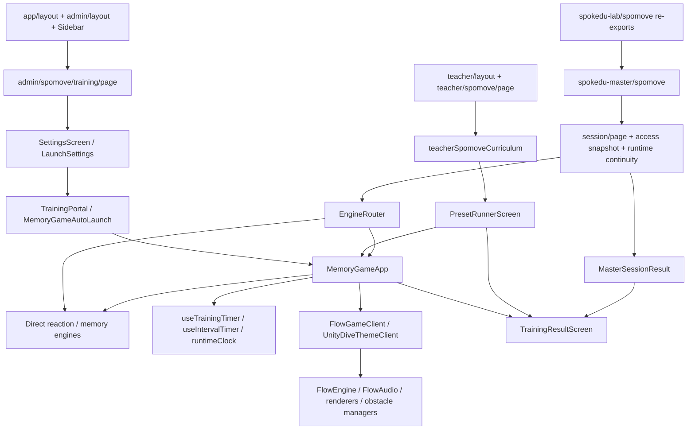

# SPOMOVE CODE FORENSIC AUDIT

감사일: 2026-10-30 (Asia/Seoul)  
최종 상태: **AUDIT_INCOMPLETE / FIX_NOT_STARTED**  
제품 소스 수정·리팩토링·DB 변경·stage·commit·push·deploy: 수행하지 않음.

## 1. 판정과 핵심 결과

이번 감사는 일부 실제 화면과 공통 엔진 결함을 재현했으나, 요청된 전체 실행·권한·기기 조합을 완료하지 못했다. 아래의 PASS는 명시된 검사 항목에만 해당한다. SPOMOVE 전체 또는 MASTER Surface Matrix의 rendered visual PASS가 아니다. P0 확정 결함은 발견하지 못했으며 P0 부재를 보증하지 않는다.

| ID | 심각도 | 판정 | 발견 사항 | 확인 수준 |
|---|---|---|---|---|
| F01 | P1 | CONFIRMED | 일시정지 플래그가 공통 타이머 진행을 막지 못함 | 실제 타이머 훅을 격리 Chromium에서 실행 |
| F02 | P1 | CONFIRMED | 중도 종료를 정상 완주로 표시하고 일부 callback에서 종료 사유 유실 | 실제 Admin 실행·중지·결과 |
| F03 | P1 | CONFIRMED | Teacher 재실행 후 목록 복귀 시 스크롤 잠금 잔류 | 실제 Teacher 흐름, 권한 응답 fixture |
| F04 | P2 | CONFIRMED | 강제 스크롤 해제가 이전 overflow 값을 복원하지 않음 | 실제 공통 함수 브라우저 실행 |
| F05 | P2 | CONFIRMED | 테마 선택에 따라 동일 테마 목록의 1열/2열 및 정보 밀도가 변경됨 | Admin 390/1440 실제 화면·computed style |
| F06 | P2 | CONFIRMED | 플레이어 CSS가 외부 요소와 문서 전체에 적용됨 | 실제 CSS를 격리 문서에 적용; 전역 theme 속성은 정적 확인 |
| F07 | P2 | CONFIRMED | Relative Compass 응답 시간 필드를 시작 시간으로 덮어 전달 | 정적 데이터 흐름; 서로 다른 값의 실제 UI 재현 미완료 |
| F08 | P2 | CONFIRMED | 플레이어 TTS 문자열 자체가 손상됨 | UTF-8 소스 리터럴 확인; 음성 재생 재현 미완료 |
| F09 | P2 | CONFIRMED | fullscreen 종료 거절 시 처리되지 않은 예외 | 실제 Admin에서 실패 주입 |
| F10 | P2 | CONFIRMED | 맞는 조각 찾아가기 선택 시 제목·가이드가 Relative Compass로 표시됨 | 10개 크기의 Admin DOM + 정적 ID 충돌 |
| F11 | P1 | LIKELY | MASTER 실행 중 경로 이탈 시 수동 획득한 스크롤 잠금 미해제 | 호출·정리 경로 확인; 로그인 MASTER E2E 미완료 |
| F12 | P1 | LIKELY | spomove 범위 계정의 화면 제한과 서버 관리자 권한 경계 불일치 | 정적 인증·API 경로; 실제 계정 호출 미수행 |
| F13 | P2 | LIKELY | Teacher 자료 접근 판정이 users 행 부재 시 허용됨 | 정적 null 경로; 계정 계약·실제 계정 검증 필요 |
| F14 | P3 | CONFIRMED | 모션 게이트 부록 버튼 높이가 44px 기준 미달 | 10개 크기 DOM 측정, 41.5px |
| F15 | P2 | LIKELY | 종료 직후 예약된 완료 음성/효과음이 이탈 뒤 실행될 수 있음 | 정적 timeout 소유권 확인; 청각·이탈 재현 미완료 |

CONFIRMED는 확인된 결함의 범위를 의미한다. 예컨대 F01의 공통 훅 재현은 전체 100개 공식 Preset의 로그인 화면 재현을 뜻하지 않는다. F07/F08은 코드 결함 확정이며 브라우저 재현 완료가 아니다.

## 2. 기준선과 변경 보존

| 항목 | 값 |
|---|---|
| HEAD / main | `685fe9eed8ee42a57ed1fea89902ffa792529094` |
| 로컬 origin/main | `685fe9eed8ee42a57ed1fea89902ffa792529094` |
| 원격 main, `git ls-remote origin refs/heads/main` | `685fe9eed8ee42a57ed1fea89902ffa792529094` |
| remote | `https://github.com/spokedu77-ops/1.git` |
| 시작 시 변경 | 미추적 `.vscode/` |
| 감사 산출물 | 기존 이 보고서 갱신과 `.spomove-audit/` 추가 |
| 제품 소스 변경 검사 | 보고서 작성 전 `git diff --exit-code` exit 0; 작성 후 app/docs/config/AGENTS 대상 diff exit 0 |

최초 sandbox 원격 조회는 로컬 네트워크 프록시 차단으로 실패했다. 읽기 전용 권한 확장 후 원격 SHA를 확인했다. fetch, 브랜치 생성, Git index 변경은 하지 않았다. 보고서의 행 번호는 위 SHA의 소스 기준이다. 기존 HEAD의 동명 보고서는 `.spomove-audit/baseline-SPOMOVE_FORENSIC_AUDIT.md`에 원본 바이트로 보존했다. 현재 보고서만 새 증거로 갱신했으며 과거 판정을 이번 검증 결과로 재사용하지 않았다.

AGENTS.md → Product Contract → Visual System → Surface Matrix → SPOMOVE Product Contract를 조사 기준으로 사용했다. 이번 문서는 사용자 요청에 따른 감사 증거이며 새로운 제품·시각 SSOT가 아니다. 기존 Surface Matrix는 수정하지 않았다.

## 3. 조사 파일과 의존성 지도

전체 파일 목록 및 import/export/dynamic import의 원본 파일·행 번호는 [dependency-map.json](.spomove-audit/dependency-map.json)에 있다. AST 방식으로 상대 경로와 `@/`를 해석했다.

| 집계 | 수 |
|---|---:|
| 최초 명시 범위와 Admin/Teacher layout의 파일 | 295 |
| API·서버 인증·루트 shell 등 추가 진입 파일 포함 | 307 |
| 도달한 소스/테스트/CSS 파일 | 395 |
| 해석된 로컬 import/export 간선 | 1,153 |
| 미해결 로컬 import | 0 |

395개는 자동으로 읽어 의존성을 집계한 파일 수다. 395개 모두를 줄 단위 수동 검토하거나 실행했다는 뜻은 아니다. 문자열 fetch, 런타임 DB 관계, 동적 에셋 경로는 import 그래프 밖이므로 아래 요청·데이터 경로를 별도로 추적했다. 전체 런타임 call graph 완성은 미완료다.



Admin/Teacher는 공통 플레이어를 거치지만 MASTER는 일부 반응·기억 엔진을 직접 호출한다. 공통 모듈을 사용한다는 이유만으로 결과 처리까지 같다고 판정하지 않았다.

| 서비스 경로 | 참조 코드와 보존해야 할 경계 | 감사 결과 |
|---|---|---|
| Admin 권한 | `admin/layout.tsx` → `/api/auth/check-admin` → `requireAdmin` → `platformAdminIdentity` | UI scope와 서버 권한 차이는 F12, 실제 계정 미검증 |
| Teacher 자료 | `teacher/layout.tsx` → `useTeacherMaterialsAccess` → `teacherAuth`; 기관 상태 별도 확인 | 실제 화면은 허용 응답 fixture, F13 정적 의심 |
| Teacher 즐겨찾기 | GET/POST `/api/teacher/spomove/favorites`, DELETE `/[id]` | GET/DELETE의 `user_id` 조건 확인. POST 최대 개수 확인은 count 후 insert로 분리되어 경쟁 요청 검증 필요 |
| 공식 프로그램 | `officialSpomovePresets` + `/api/spokedu-master/programs` + store | 코드 카탈로그 100개 집계. 실제 CMS overlay와 DB는 미검증 |
| 가이드 미디어 | `useSpomoveGuideVideo` → `/api/spokedu-master/spomove/guide-video` → preset access | 서버 접근 함수 호출과 기존 테스트 확인, 실제 서명 URL·미디어 실패 미검증 |
| 관리자 에셋 | `useSpomoveDiveEnvironments`, `VariantAppendixFullscreen` → `/api/admin/think-asset-pack` → service client | 쓰기 호출은 차단. 접근 범위 F12 검토 필요 |
| MASTER 실행 지속성 | `session/page` → `runtimeContinuity` sessionStorage, recent config store | 종료 receipt와 active snapshot 테스트 통과. 정지 시간 포함 가능성은 F01 영향 |
| 수업 활동 완료 | `session/page.tsx:990` → PATCH `/sessions/[sessionId]/programs/[sessionProgramId]` | 응답 실패 시 error 상태 경로 확인. 실제 소유자·기관·동시성 검증 미완료 |

LAB Hub·Session은 MASTER 페이지를 re-export하고 layout도 공유한다. 따라서 엔진·세션 코드 결함은 두 URL 계열의 후보 영향이다. 두 URL에서 각각 로그인한 재현은 하지 않았다.

## 4. 실행 환경과 증거의 신뢰 범위

- Next.js 16.2.11 개발 서버: `http://127.0.0.1:3107`, Playwright Chromium headless.
- 감사용 공통 함수 harness: `127.0.0.1:3108`, Vite 번들. 제품 소스를 import하여 실행했으며 복제 구현으로 대체하지 않았다.
- 매 실행마다 신규 browser context, service worker 차단. localhost 외 요청 차단, localhost의 쓰기 요청도 차단.
- Admin `/api/auth/check-admin` 응답은 `{admin:true}` fixture. Teacher 자료 허용 응답과 비기관 응답도 fixture.
- 그 외 API 요청에는 감사용 실패 응답을 사용했다. 외부 Supabase·오디오·미디어 요청은 차단했다. 따라서 실제 에셋이 채워진 정상 운영 화면 PASS로 해석할 수 없다.
- 운영 URL, Vercel Production/Preview, 운영 이미지 변환 요청을 사용하지 않았다.
- 초기 Next/Chromium/Vitest는 sandbox의 `spawn EPERM`으로 실패했고, 로컬 검증용 권한 확장 후 실행했다. 설치·업데이트는 하지 않았다.
- `.spomove-audit/*.cjs`, `probes-entry.tsx`는 감사 재현 도구다. 제품 코드 수정이 아니며 감사 산출물로만 남겼다.

주요 증거:

| 파일 | 내용 |
|---|---|
| `matrix.json`, `matrix.cjs` | 34개 Admin 설정 테마 × 10개 크기 DOM·computed style·버튼 치수 |
| `variants.json`, `variants.cjs` | 난이도 label을 가진 section의 개별 옵션 순회 108회 |
| `simon-stable-{4,5}-{390,1440}.png` | 안정화 후 랜덤/카모플라쥬 비교 화면 |
| `runtime.json`, `runtime-{running,result}.png` | Simon 10회 실행·완료 및 fullscreen 시작 거절 |
| `stop.json`, `stop-{running,result}.png` | 시지각 반응 60초 중 약 6초에 중단한 결과 |
| `teacher.json`, `teacher-weeks.png` | Teacher 주차 목록 실제 렌더 |
| `teacher-retry.json`, `teacher-after-retry.png` | Teacher 중지·재실행·목록 복귀와 overflow 잔류 |
| `probes.json`, `probes-entry.tsx`, `probes.cjs` | 공통 타이머·스크롤·CSS 함수 실행 결과, 공식/Teacher 카탈로그 집계 |
| `exit-fullscreen.json` | fullscreen 종료 거절 주입과 pageerror |
| `vitest.json`, `access-tests.json`, `eslint.json`, `typescript.log` | 정적·기존 테스트 결과 |

`matrix.cjs`는 viewport 변경 후 30ms에 측정했다. 전환 애니메이션 중의 위치·스크린샷은 확정 레이아웃 증거로 사용하지 않았다. `variants.cjs`는 350ms, `simon-stable` 스크린샷은 500ms 안정화 후 수집했다. 초기 `simon-*` 및 첫 `matrix`의 위치 값은 안정화 스크린샷보다 낮은 신뢰도의 보조 증거다. 초기 부록 모달을 설정 행으로 취급한 시도는 폐기하고 최종 matrix에서 제외했다.

## 5. 확정 결함 상세

### F01 — 일시정지 중 자극·완료 진행 / P1 / CONFIRMED

- 위치: `training/_player/lib/runtimeClock.ts:6`, `:20`, `:38`, `:47`, `:56`; `hooks/useTrainingTimer.ts:195`; `spokedu-master/spomove/session/EngineRouter.tsx:295`; `session/page.tsx:576`.
- 재현: 실제 `useTrainingTimer`를 speed 0.2초, reps 10, audio off로 mount. 약 350ms 후 `setSpomoveRuntimePaused(true)`, 2.1초 기다림.
- 기대: 정지 중 신호 수·active elapsed·완료 상태가 변하지 않음.
- 실제: `paused=true`, `pausedAt=2`, 이후 `after=10`, `done=true`.
- 근본 원인: pause는 boolean 및 listener 통지만 바꾼다. now/RAF/timeout/interval wrapper는 원시 브라우저 함수를 그대로 호출한다. 공통 훈련 훅은 pause를 검사하지 않는다.
- 영향: MASTER/LAB의 pause overlay 아래 공통 플레이어 훈련이 진행·종료될 수 있다. `elapsedActiveMs`, 움직임 변경 시각, 결과 시간도 pause 시간을 포함할 수 있다. 일부 엔진·오디오의 개별 pause listener가 있어도 전체 시계를 정지시키지는 않는다. 모든 엔진에서 동일 증상이라고 단정하지 않는다.
- 증거: `probes.json.pauseOutcome`, `probes-entry.tsx`; 실제 로그인 MASTER overlay 흐름은 UNVERIFIED.
- 최소 수정안: pause-aware active clock과 예약 작업 정책을 정하고 공통 타이머부터 적용. pause 직전 RAF, timeout 잔여 시간, resume와 terminal 전이 중복 방지 필요.
- 회귀 위험: DIVE/Unity·오디오·워밍업·interval에 서로 다른 시간 기준이 존재하므로 전역 wrapper만 성급히 바꾸면 순서·종료 조건이 달라진다.

### F02 — 중도 종료가 완주로 표시 / P1 / CONFIRMED

- 위치: `components/VisualReactionTraining.tsx:657-669`; `MemoryGameApp.tsx:1333-1341`, `:1288-1293`, `:3028`; `components/TrainingResultScreen.tsx:33`, `:166`.
- 재현: Admin → 시지각 반응 → 풍선 → 60초 기본 설정 → 시작 → 약 6초에 중지.
- 기대: 중도 종료와 실제 진행 시간을 표시하고 callback에서도 `stoppedEarly` 보존.
- 실제: 진행 시간 6초/설정 분량 60초인데 “훈련 완료”, “시지각 반응을 끝까지 완주했어요.”, “끝까지 힘차게 움직였어요” 표시.
- 근본 원인: child는 `stoppedEarly:true`를 보낸다. `handleReactTrainComplete`는 이를 `deliverSessionResult`의 meta로 전달하지 않는다. 일반 STOP 경로가 meta를 보존하더라도 Admin result 호출은 `completionReason`을 전달하지 않아 기본 완료 표현을 사용한다. Teacher 결과 호출도 종료 사유를 전달하지 않는다.
- 영향: Admin·Teacher의 반응 계열 결과. MASTER `EngineRouter.handleReactTrainComplete`는 사유를 변환하는 별도 구현이 있으므로 같은 callback 결함을 그대로 적용하지 않는다.
- 증거: `stop.json.result.text`, `stop-result.png`. 정상 완료 비교는 `runtime-result.png`.
- 최소 수정안: child → 공통 callback → Teacher/Admin result까지 동일 terminal reason 보존. 문구와 결과 데이터 양쪽을 함께 검증.
- 회귀 위험: 일반 STOP/자식 STOP/취소/오류를 일괄 natural_complete로 합치지 않아야 한다. 통계 색상·설정값·재실행 동작 보존 필요.

### F03 — Teacher 재실행 스크롤 잠금 누적 / P1 / CONFIRMED

- 위치: `teacher/spomove/page.tsx:2570`, `:3095-3099`; `TrainingResultScreen.tsx:197`의 `useViewportScrollLock(true)`; `lockViewportScroll.ts:8-24`.
- 재현: 로컬 Teacher(자료 허용 fixture) → Spomove → 1주차 첫 프로그램 → 시작 → STOP → 다시 실행 → STOP → 목록.
- 기대: 프리셋 목록으로 복귀하면 플레이어와 결과의 잠금이 모두 해제됨.
- 실제: 프로그램 목록 DOM이 보이지만 `htmlOverflow=hidden`, `bodyOverflow=hidden` 잔류.
- 근본 원인: `onRetry`의 수동 `lockViewportScroll()`에 대응하는 release가 없다. Runner/Player/Result의 effect lock은 각각 정리되어도 추가 reference가 남는다.
- 영향: Teacher 내 목록·다른 경로의 스크롤. 반복 retry마다 추가 누적 가능. Admin 강제 해제는 Teacher의 이 경로에 없다.
- 증거: `teacher-retry.json.afterRetry`, `teacher-after-retry.png`; 동일 호출 균형 함수 검증 `probes.json.teacherRetryBalance`.
- 최소 수정안: 화면별 소유권과 전환 handoff를 정리하고 획득마다 정확히 1회 release. 강제 reset으로 가리는 방식은 F04 회귀 위험.
- 회귀 위험: 전환 순간 스크롤 풀림 방지 목적을 유지해야 하며 StrictMode 이중 effect 및 반복 retry 검증 필요.

### F04 — forceUnlock 이전 스타일 유실 / P2 / CONFIRMED

- 위치: `lockViewportScroll.ts:28-31`; Admin `training/page.tsx:649`, `:3413`.
- 재현: html overflow=`clip`, body overflow=`scroll` → lock → forceUnlock.
- 기대: 최초 저장한 `clip`/`scroll` 복원.
- 실제: 둘 다 빈 문자열.
- 원인: saved 값 대신 항상 `''` 대입하고 전체 reference count를 0으로 만든다.
- 영향: Admin portal 종료, 같은 문서를 쓰는 다른 모달/overlay 잠금. 다른 소유자의 활성 잠금까지 무효화할 수 있다.
- 증거: `probes.json.forceRestoration`.
- 최소 수정안/위험: 저장값 복원과 소유권별 release를 함께 검토. 다른 모달이 아직 잠금 중인 사례를 포함해야 한다.

### F05 — 내부 level 조건으로 목록 배치 변경 / P2 / CONFIRMED

- 위치: Admin `training/page.tsx:1047-1051`, `:1084`, `:1102-1105`; `constants.ts:143-147`.
- 재현: Simon 4번 랜덤 테마와 5번 카모플라쥬를 번갈아 선택, 390/1440px에서 비교.
- 기대: 같은 세부 테마 목록이 선택값만으로 불필요하게 재배치되지 않음.
- 실제: 랜덤(내부 ID 3)은 `compact-menu` + 2열 grid, 카모플라쥬(내부 ID 4)는 세로 flex. 글자 크기·padding·section 간격도 같이 바뀐다.
- 원인: 프로그램 역할이 아닌 특정 내부 level ID가 compact 조건이다.
- 확장: Flanker 극단(ID 3)만 compact, 다른 Flanker는 기본. Sequential Memory 순간기억(level 7)만 compact, 순서/랜덤기억은 기본. 시지각 반응은 모든 테마 compact. 반응 인지 기본 테마들은 기본 layout이다. 이 분기 존재와 계산값은 확인했지만 각 차이의 제품적 허용 여부는 개별 검토 대상이다.
- 증거: `matrix.json`, `variants.json`, `simon-stable-{4,5}-{390,1440}.png`.
- 최소 수정안/위험: 동일 역할 목록의 layout 기준을 level 선택에서 분리. 넓이뿐 아니라 긴 이름·최소 터치 높이·짧은 가로 화면·고급 설정 펼침을 비교해야 한다.

### F06 — 전역 CSS와 theme 소유권 / P2 / CONFIRMED

- 위치: `styles.ts:27-44`; `MemoryGameApp.tsx:616-619`; `SpomoveCatalogHero.tsx:70-73`.
- 재현: 실제 exported CSS를 다른 버튼이 있는 격리 문서에 삽입.
- 기대: 플레이어 밖의 문서/버튼 스타일은 플레이어 CSS의 영향을 받지 않음.
- 실제: body overscroll이 `auto` → `none`; root `--bg`가 전역 설정됨. 소스의 universal margin/padding reset과 전역 button hover/active도 선택자 범위가 문서 전체다.
- 원인: `<style>{CSS}</style>`에 전역 root/body/universal/button 선택자 사용. theme effect는 documentElement를 변경하며 이전 값을 복구하는 cleanup이 없다.
- 영향: portal 뒤에 남은 Admin shell·Teacher chrome, MASTER에 공통 플레이어를 embed한 경로. CSS style 태그 제거 후까지 모든 규칙이 지속된다고 주장하지 않는다. html theme 속성의 잔류와 style 태그의 수명은 별개다.
- 증거: `probes.json.css`; 소스 위 행. 외부 버튼 transform의 실제 press 시각 비교는 미검증.
- 최소 수정안/위험: CSS와 변수를 runtime root에 한정하고 문서 속성의 소유권·복원 정책 정의. Result·Teacher가 같은 CSS 변수를 사용하는 점을 포함해 검토해야 한다.

### F07 — Relative Compass 응답 시간 매핑 / P2 / CONFIRMED (STATIC)

- 위치: Admin `training/page.tsx:700-701`, `:511`, `:2220`; `MemoryGameApp.tsx:817-818`, `:2670`.
- 조건: 복원/autoLaunch에서 startSeconds와 responseSeconds가 다른 상태.
- 기대: 두 필드를 각각 전달.
- 실제: portal에서 `relativeCompassResponseSeconds: launch.relativeCompassStartSeconds` 전달.
- 원인/영향: 설정 객체의 독립 필드가 경계에서 덮인다. 현재 화면 slider는 두 필드를 동시에 갱신하므로 일반 클릭만으로 서로 다른 값을 만들 수 없으며 기본 UI 증상은 미재현이다. 향후 복원·외부 호출 시 오동작 가능한 잠재 결함이다.
- 증거: 해당 caller/consumer 소스. 브라우저에서 서로 다른 값의 복원은 UNVERIFIED.
- 최소 수정안/위험: 필드 매핑 또는 단일 시간이라는 명시적 계약 중 하나를 승인 후 선택. 무조건 두 UI 제어를 새로 추가하면 제품 변경이다.

### F08 — 손상된 TTS 리터럴 / P2 / CONFIRMED (STATIC)

- 위치: `MemoryGameApp.tsx:925`, `:1170`, `:1190`.
- 조건: `audioMode`가 off/beep 이외인 훈련 시작·완료.
- 기대: 명확한 한국어 시작/완료 음성.
- 실제: 시작 문자열이 반복 `?`, 완료 문자열이 `?`와 손상 문자로 된 소스 리터럴이다. 주석이나 터미널 인코딩 표시만의 문제가 아니다.
- 원인/영향: 리터럴 자체 손상, 시작 안내·완료 안내. 기본 beep 실행에서는 해당 TTS 분기를 지나지 않았다.
- 증거: UTF-8 소스 위 행. TTS 엔진의 실제 청각 출력은 UNVERIFIED.
- 최소 수정안/위험: 승인된 한국어 원문으로 복원하고 문자열 snapshot/금지 패턴 검사. 이번에 순회한 실제 설정/결과 버튼 텍스트에서는 깨진 버튼 문구를 확인하지 못했다. “UI 버튼도 손상”이라는 선확인 주장은 전 경로에 대해 확정하지 않는다.

### F09 — fullscreen 종료 거절 미처리 / P2 / CONFIRMED

- 위치: `MemoryGameApp.tsx:917`, `:1273`, `:1308`, `:1335`; 중복 요청 `training/page.tsx:3267` 및 `MemoryGameApp.tsx:1026` 등. MASTER 상위 handler는 `session/page.tsx:684`에서 catch하지만 하위 플레이어 호출까지 대신 처리하지 못한다.
- 재현: 로컬 Simon 실행에서 fullscreenElement 존재를 주입하고 exitFullscreen을 reject하게 한 뒤 자연 완료.
- 기대: 종료 실패가 처리되고 fallback 결과를 유지하며 unhandled rejection 없음.
- 실제: pageerror `AUDIT_EXIT_FULLSCREEN_DENIED` 1건. 결과 화면은 생성됐으므로 전체 화면 종료 실패가 결과 전이를 전부 막았다고 주장하지 않는다.
- 별도 정상 확인: fullscreen 시작 요청을 reject한 실제 Admin 실행도 결과까지 도달. 동일 실행에서 요청 횟수 2회 기록. 중복 요청 존재 자체를 crash로 판정하지 않는다.
- 영향: Admin·Teacher·MASTER에서 MemoryGameApp을 거치는 경로. Safari/iOS 실기기는 UNVERIFIED.
- 증거: `exit-fullscreen.json.errors`, `runtime.json.result.state.fullscreenCalls`.
- 최소 수정안/위험: request/exit 책임과 promise 처리 일원화, gesture 구간 유지. 중복 제거가 오디오 활성화·iPad gesture를 깨지 않도록 별도 검증 필요.

### F10 — Shape Completion 제목/가이드 ID 충돌 / P2 / CONFIRMED

- 위치: `constants.ts:322-334`; Admin `training/page.tsx:124-129`, `:277-288`, `:1035-1038`, `:1257-1258`.
- 재현: 반응 인지 → 8번 맞는 조각 찾아가기.
- 기대: header와 엔진·난이도 안내가 선택한 8번 활동을 가리킴.
- 실제: 화면 header와 guide toggle이 7번 내 자리에서 방향 따라가기(Relative Compass)로 표시됨. 난이도 버튼은 Shape Completion용이므로 화면 내부의 활동 정체성이 불일치한다.
- 원인: catalogBasicUiLevel은 이전 modified-quadrant level 8도 7로 정규화한다. 신규 Shape Completion도 level 8을 사용하지만 label helper는 shapeCompletionEnabled를 받지 않는다.
- 영향: Admin header/설정 요약/guidePhase 선택. runtime은 별도 flag 분기를 가지므로 실제 엔진이 Relative Compass로 실행된다고 추론하지 않는다.
- 증거: `matrix.json`의 Reactive Cognition themeIndex 7 전 10개 width; 소스 mapping.
- 최소 수정안/위험: 신규 활동과 legacy ID의 표시 해석을 구분. 레거시 Teacher modified quadrant/재실행 복원을 깨지 않도록 test matrix 필요.

### F14 — 부록 버튼 터치 높이 / P3 / CONFIRMED

- 위치: `components/ColorGatePoseAppendix.tsx:247`의 부록 toggle, Admin `training/page.tsx:1107-1108`.
- 재현: DIVE → 모션 게이트 → 부록 열기 버튼 치수 측정.
- 기대: 지정된 44px 최소 터치 높이.
- 실제: 10개 크기 모두 41.5px. 내부 자식 컴포넌트에 styled-jsx의 부모 button 규칙이 동일하게 적용되지 않는 것으로 보인다. 원인 세부 우선순위는 LIKELY이며 치수는 CONFIRMED다.
- 영향/증거: 모션 게이트 부록 버튼, `matrix.json.rows[].smallButtons`.
- 최소 수정안/위험: 실제 버튼 소유 컴포넌트의 최소 hit area 보장. 이미지/pose 필터 자체를 바꿀 필요는 없다.

## 6. 추가 의심과 미검증

### F11 — MASTER route 이탈 잠금 / P1 / LIKELY

`session/page.tsx:768`에서 수동 lock, `:833`의 finishSession에서 unlock. 페이지 effect의 unmount는 `:905`에서 clock reset만 한다. `leaveSession(:946)`도 unlock 없이 router.push한다. 시작 후 뒤로 가기/경로 이동으로 finish를 통과하지 않으면 상위 lock 1개가 남을 수 있다. 기대는 이탈 시 해당 소유권 release다. 실제 로그인 MASTER route 이탈은 미검증이다. Admin 강제 해제와 혼동하지 말아야 한다. 최소 수정은 acquisition에 대응하는 idempotent release와 정상 종료 시 이중 release 방지이며, 중첩 엔진 lock 회귀 위험이 있다.

### F12 — scope가 화면에만 적용됨 / P1 / LIKELY

`api/auth/check-admin/route.ts`는 특정 계정에 `scope:'spomove'`를 반환하고 `admin/layout.tsx:51/61/86`은 training 이외 경로를 돌려보낸다. 반면 `platformAdminIdentity.ts:5-9`는 해당 계정을 플랫폼 관리자로 분류하고 `adminAuth.ts:101` 부근은 known admin을 허용한다. `api/admin/think-asset-pack/route.ts:17-19`는 requireAdmin만 호출한 뒤 요청된 pack ID를 처리한다.

예상 재현은 해당 계정으로 다른 pack ID의 요청을 보내는 것이다. **운영 변경을 피하기 위해 요청하지 않았다.** scope가 보안 제한이라는 계약이라면 서버 제한이 빠진다. 전체 관리자에게 단순 초기 화면만 제한하는 의도라면 취약점 판정은 FALSE POSITIVE가 될 수 있다. 사용자/제품 계약 확인과 mock service fixture의 거부 테스트가 필요하다. 임의로 서버 권한을 축소하는 수정은 승인 범위 밖이다.

### F13 — Teacher users 행 부재 허용 / P2 / LIKELY

`teacherAuth.ts:55-62`의 users maybeSingle 후 `data?.is_active !== false`는 행이 없을 때도 true다. 기대가 등록된 활동 강사만 허용이라면 미등록 인증 계정은 거부되어야 한다. 기관 계정은 앞 단계에서 차단되지만 일반 계정의 users 행 부재까지 차단하지 않는다. 행 생성 보장 여부, 허용 사용자 정의 및 실제 계정 검증이 필요하다. 즐겨찾기 user_id isolation 자체를 우회한다는 증거는 없다. 최소 수정 후보는 명시적 사용자 존재/역할 정책이며 신규 계정 onboarding 회귀 위험이 있다.

### F15 — 완료 음성 timeout 수명 / P2 / LIKELY

`MemoryGameApp.tsx:924-925`에서 완료 후 200/300ms timeout을 만들지만 handle을 저장하지 않는다. unmount cleanup `:1358-1375`는 다른 timer/dupFlash/BGM만 정리한다. 기대는 이탈 후 이전 세션의 완료 음성·효과음이 재생되지 않는 것이다. 완료 즉시 목록/재실행/다른 서비스로 이탈하면 예약 callback이 남을 수 있다. 실제 청각 재현은 하지 않았다. 최소 수정 후보는 callback handle과 TTS 소유권 cleanup이며 다음 세션 음성을 함께 cancel하지 않도록 회귀 검증해야 한다.

그 외 확인 필요 항목:

- Teacher 즐겨찾기 POST의 개수 제한은 count→insert의 별도 요청이다. DB 제약/트랜잭션과 병렬 저장 검증 없이 “10개 제한 보장”을 선언할 수 없다.
- `flowPresets.ts:80` 이후 localStorage.getItem은 try 밖이다. storage 거부 브라우저의 초기 진입 예외 여부 미검증.
- FlowEngine에는 RAF/timer/audio/renderer/geometry dispose 경로가 존재한다. 이 사실만으로 GPU 메모리·late loader·반복 Unity 실행의 누수 부재를 선언하지 않았다.
- 모든 무작위 자극의 정답·분포, 빈 후보 배열, media 실패 후 fallback의 지도 적합성은 전체 실행 미완료다.

## 7. 화면·상태·해상도 커버리지

코드 카탈로그: 공식 Preset 100개(`isReady` 모두 true), Teacher 8주/33개 프로그램. Admin은 카탈로그 대표 설정 34개 + 이미지 부록 1개다. Admin 34개를 공식 100개의 전체 실행 검증으로 환산하면 안 된다. 카탈로그 집계는 `probes.json.catalog`에 있다.

| Admin 프로그램 | 설정 테마 수 | 기본 설정 DOM 검사 | 난이도 별도 순회 |
|---|---:|---:|---|
| 반응 인지 | 8 | 80 | label 기반 개별 옵션 |
| 시지각 반응 | 10 | 100 | label 기반 개별 옵션, 보류 항목도 설정 진입 |
| 사이먼 | 5 | 50 | 각 테마 보통/어려움 |
| 플랭커 | 4 | 40 | 노출 난이도, 원 속의 원은 설정만 |
| 스트룹 | 2 | 20 | 노출 난이도; 규칙·응답 방식 Cartesian 조합 제외 |
| 순차 기억 | 3 | 30 | 순서/랜덤의 label 기반 난이도; 순간기억 크기·노출 방식 전체 조합 제외 |
| DIVE | 2 | 20 | 난이도 label 없음; category/difficulty/환경 전체 조합 제외 |
| 합계 | 34 | 340 | 추가 측정 108행 |

해상도: 320×740, 360×800, 390×844, 430×932, 768×1024, 1024×768, 1280×800, 1440×900, 1920×1080, 모바일 가로 844×390. 난이도 추가 순회는 390×900/1440×900이다. 세부 raw 행은 `matrix.json`, `variants.json` 참조.

| 검증 단위 | 전체 대상 | 실제 검증 | PASS | FAIL | 미검증/유보 및 사유 |
|---|---:|---:|---:|---:|---|
| Admin 기본 설정 테마×크기, document 가로 overflow 검사 | 340 | 340 | 340 | 0 | 전환 후 위치 안정성·겹침 전체 검사는 포함하지 않음 |
| 같은 340행, settings-body 버튼 높이 ≥44px 검사 | 340 | 340 | 330 | 10 | 폭·접근 가능한 이름·키보드 동작 전체를 의미하지 않음 |
| 난이도 label section 개별 선택 후 가로 overflow | 108 | 108 | 108 | 0 | 54 선택×2폭, 연속 선택이며 Cartesian 조합 아님 |
| Simon 랜덤/카모 layout 일관성 비교 | 2 viewport 쌍 | 2 | 0 | 2 | 안정화 screenshot 4장 직접 검토 |
| Admin Simon 자연 완료 + fullscreen 시작 실패 fallback | 1 시나리오 | 1 | 1 | 0 | 다른 엔진·기기 성공을 뜻하지 않음 |
| Admin 시지각 반응 중지 후 종료 상태 표시 | 1 시나리오 | 1 | 0 | 1 | F02 |
| Teacher 재실행 후 목록 잠금 해제 | 1 시나리오 | 1 | 0 | 1 | F03, 허용 응답 fixture |
| 공통 timer pause / force restore / retry lock balance | 3 시나리오 | 3 | 0 | 3 | 격리 함수/훅 검증 |
| fullscreen 종료 거절 처리 | 1 시나리오 | 1 | 0 | 1 | 오류 주입, 실기기 거절과 구분 |
| 기존 SPOMOVE 테스트 | 753 | 753 | 753 | 0 | rendered PASS 아님 |
| 추가 기존 접근/가이드 테스트 | 32 | 32 | 32 | 0 | 실계정 보장 아님 |
| TypeScript | 1 | 1 | 1 | 0 | 프로젝트 tsc, emit/incremental 꺼짐 |
| 대상 ESLint 파일 | 291 | 291 | 291 | 0 | 경고 0, 오류 0 |
| Next production build | 1 | 0 | 0 | 0 | 1 미검증. 전체 앱 prerender의 외부 데이터 접근을 별도로 격리하지 않음; harness Vite build와 구분 |
| 공식 100개, 실제 로그인 전 과정 실행 | 100 | 0 | 0 | 0 | 100 미검증. 공식 경로의 인증·CMS fixture 없음 |
| Teacher 33개 프로그램 전체 실행 | 33 | 1 | 0 | 1 | 나머지 32 미검증. 첫 프로그램 retry 경로만 실제 수행 |

Admin의 대표 34개×10크기×7화면 단계만 계산해도 기준 슬롯이 2,380개다. 이번 340행은 설정 단계에 해당한다. 별도 프로그램·난이도·theme 옵션의 조합으로 전체 분모는 더 커진다. 전체 옵션 상태 공간을 아직 추출하지 않았으므로 정확한 전체 분모 및 전체 PASS/FAIL 비율은 **미확정**이다. 추가 108행을 서로 다른 전체 실행 상태 108개라고 계산하지 않았다.

| 요청 단계/특수 상황 | 수행 범위 | 남은 범위 |
|---|---|---|
| 카탈로그 → 설정 | Admin 7프로그램/34테마, Teacher 주차/첫 프로그램 | 공식 Hub의 채워진 CMS/계정별 화면 |
| 가이드 | toggle/선택 라벨 소스와 F10 | 모든 가이드 펼침·영상·내용 대조 |
| 실행 → 중지/완료 → 결과 | Admin 2개 대표 실행, Teacher 1개 반복 | 나머지 mode/engine level·100 Preset 전체 |
| 복귀/재실행 | Teacher 실제 반복, Admin result 구현 추적 | Admin 각 엔진 retry, MASTER confirmation/record E2E |
| 짧은 가로 높이 | 844×390 설정 DOM | 실제 iOS Safari safe area, 모든 running/result scroll |
| 브라우저 확대 | 미수행 | 확대 125/150/200%, 글꼴 확대 |
| fullscreen 실패 | 시작 reject·종료 reject 주입 | 실제 ESC, 실제 iPad fullscreen 제한, 회전 |
| 뒤로/새로고침 | 소스/continuity 기존 테스트 | 실행 중 실제 route 전환·새로고침·복구 |
| 네트워크/미디어 오류 | API 실패 및 원격 차단 상태로 설정/대표 실행 | 에셋별 timeout/404/decode 실패, 정상 로드와 비교 |
| listener/timer/메모리 | 정리 코드 검토, pause/retry 결함 재현 | 장시간 heap/GPU/AudioContext, 반복 mount 계측 |
| 권한/기관/플랜 | 서버 분기 정적 검토, 기존 테스트 32개 | Free/Lite/Premium/admin/기관·활동/종료강사 실계정 matrix |

따라서 “모든 mode/level 런타임 전수검증”과 “모든 난이도×세부 theme 전수검증”은 **미완료**다. 후속 감사에는 실제 데이터를 쓰지 않는 인증·CMS·저장소 fixture가 필요하다. 사용자에게 운영 DB 변경을 요청하거나 기존 계정 정보를 추측해 로그인하지 않았다.

## 8. 교차 영향 및 오탐 구분

| 결함군 | Admin | Teacher | MASTER / LAB |
|---|---|---|---|
| 공통 pause 시계 | 공통 모듈 사용, pause UI 경로 별도 | 공통 모듈 사용 | pause overlay와 직접 연결, F01 영향 우선 |
| child 중단 사유 유실 | 실제 재현 | 같은 MemoryGameApp callback 및 결과 미전달 | direct EngineRouter callback은 사유 변환 구현 존재 |
| retry lock 누적 | force reset 별도 존재 | 실제 재현 | 별개 start/unmount lock F11 |
| compact 목록 | 실제 설정 화면 결함 | Admin SettingsScreen은 사용하지 않음 | 자체 Setup으로 동일 layout 분기 미사용 |
| CSS/문서 theme | 플레이어·카탈로그 | 플레이어/결과 CSS | 공통 플레이어 embed 경로 |
| Relative Compass portal 매핑 | 해당 TrainingPortal | 해당 portal 미사용 | 해당 portal 미사용 |
| Shape label ID | 해당 Admin helper | legacy level 의미와 회귀 관계 | 공통 ID 사용 여부는 개별 caller 기준 추가 확인 |
| fullscreen 종료 | 공통 플레이어 | 공통 플레이어 | 상위 catch 존재해도 하위 호출은 영향 가능 |

FALSE POSITIVE / 미확정 처리:

1. 초기 스크린샷의 모바일 고정 header 위치와 데스크톱 sidebar 절단처럼 보인 현상은 viewport 전환 도중 수집 영향이 있었다. 안정화 화면으로 대체했으며 전역 레이아웃 결함으로 확정하지 않았다.
2. 초기 감사 harness HTML의 UTF-8 선언 누락으로 Teacher 카탈로그가 깨져 보였다. harness 선언을 바로잡고 실제 Next Teacher 화면의 정상 한글을 확인했다. Teacher 원본 카탈로그 문자열 손상 주장은 FALSE POSITIVE다. F08의 원본 TTS `?` 문자열과 구분한다.
3. 전체화면 시작 거절 자체는 실행 중단으로 재현되지 않았다. fallback은 대표 시나리오에서 통과했다.
4. 숫자 연산 기차·바이러스·원 속의 원의 Admin 보류 노출은 코드상 의도된 상태가 있다. Admin에 보인다는 이유만으로 공개 entitlement 결함으로 분류하지 않았다.
5. Teacher 즐겨찾기의 GET/DELETE에는 user_id 조건이 존재한다. 타인의 데이터 접근이 가능하다고 주장하지 않는다.
6. 정적 dispose/cleanup의 존재는 누수 부재의 PASS가 아니며, 누수 가능성이라는 추측만으로 모든 컴포넌트를 FAIL로 표시하지 않았다.

## 9. 테스트 결과와 사각지대

실행 명령:

```text
node node_modules/vitest/vitest.mjs run app/admin/spomove/training/_player app/spokedu-master/spomove app/lib/spomove --reporter=json --outputFile=.spomove-audit/vitest.json
node node_modules/vitest/vitest.mjs run app/api/spokedu-master/spomove app/lib/server/teacherAuth app/lib/server/spokeduMasterAccess app/spokedu-master/lib/masterAccessModel app/spokedu-master/lib/spomoveTrialAccess --reporter=json --outputFile=.spomove-audit/access-tests.json
node node_modules/typescript/bin/tsc --noEmit --incremental false --pretty false
node node_modules/eslint/bin/eslint.js app/admin/spomove app/teacher/spomove app/spokedu-lab/spomove app/spokedu-master/spomove app/lib/spomove app/admin/layout.tsx app/teacher/layout.tsx --format json --output-file .spomove-audit/eslint.json
```

- SPOMOVE: 76개 test file / 753 tests PASS.
- 접근·가이드 관련 추가 선택: 6개 test file / 32 tests PASS. 명령에 지정한 이름별로 테스트 파일이 존재한다고 가정하지 말고 JSON testResults의 실제 6개 파일을 기준으로 본다.
- TypeScript exit 0, 로그 빈 파일(진단 없음).
- ESLint 291개 파일, error 0 / warning 0.
- Next production build 실행 안 함. `package.json` build/typecheck/lint/test script와 Next config·Vitest include를 검토했다. 기존 `lint` 기본 script는 SPOMOVE 전역 검증을 의미하지 않아 대상 경로를 명시했다.

사각지대: `sessionRuntimeLifecycle.test.ts`는 전이 허용 predicate를 확인하지만 pause 동안 실제 훅/RAF가 멈추는지는 확인하지 않는다. source-string contract들은 특정 handler/코드 토큰 존재를 확인하므로 callback payload 유실·컴포넌트 간 lock reference 누적·computed layout 전환을 통과시킬 수 있다. 기존 테스트의 PASS와 F01/F02/F03은 모순되지 않는다.

추가 테스트 설계(제품 수정 없음):

| 우선 | 설계 | 필수 assertion |
|---|---|---|
| 1 | hook fake clock + 실제 browser pause | pause 동안 신호·active elapsed·완료 0 변화, resume 잔여 시간 유지 |
| 1 | child stop → MemoryGameApp → Teacher/Admin/MASTER 결과 통합 | stopped_early 보존, 정상 완료 문구 금지, retry config 동일 |
| 1 | Teacher 3회 retry + 종료/목록/route 이탈 | 초기 inline overflow로 복원, 다른 modal lock 보존 |
| 1 | MASTER start → back/unmount → 다른 화면 | 소유 lock 0, BGM/TTS/RAF 정리, 새 세션 정상 |
| 2 | catalog ID/flag 조합 표시·실행 일치 | Shape Completion, Relative Compass, legacy modified quadrant 구분 |
| 2 | 모든 설정 테마의 안정화 390/1440 비교 | 목록 열·타이포·hit target 기준, 가이드/고급 펼침 포함 |
| 2 | fullscreen start/exit reject 및 API 부재 | unhandled rejection 0, fallback 실행/결과/복귀 가능 |
| 2 | 100개 공식 Preset engine config round-trip | 속도/횟수/interval/환경/결과/recent/rerun 동일 |
| 2 | 계정·플랜·기관 및 미등록 users row fixture | UI와 서버 거부 일치, user/tenant isolation, scope 계약 반영 |
| 3 | asset 404/decode·오디오 차단·storage 거부 | 오류·취소·중단 구분, false success 없음 |
| 3 | 장시간/반복 Flow·Unity | GPU/heap/audio/listener 증가 추세와 late loader 정리 |

## 10. 최소 수정 순서와 별도 승인 계획

수정은 시작하지 않았다. 아래는 승인 후보이며 구현 승인으로 간주하지 않는다.

1. **첫 승인 묶음: 런타임 의미 보존.** F01 pause 시계, F02 terminal reason, F03/F04/F11 잠금 소유권을 독립된 재현·수용 조건으로 정리한다. 엔진 시간 의미·기록 결과를 바꾸므로 변경 전 현재 공식/legacy 동작 계약을 확정한다.
2. **두 번째 묶음: 표시와 실패 처리.** F05/F10 layout/label, F08 TTS 원문, F09 fullscreen promise, F14 hit area. 첫 묶음과 섞어 전역 리팩토링하지 않는다. 각 대상 파일과 회귀 범위를 승인받은 후 수정한다.
3. **별도 권한 결정.** F12 scope의 의미, F13 미등록 users 허용 정책은 제품·보안 결정이 필요하다. 실제 쓰기 없는 mocked service 테스트로 현재 허용 경로를 먼저 입증하고 허용/거부 기준 승인 후 구현한다.
4. **감사 잔여 범위 완료.** 비운영 인증·CMS·미디어 fixture를 마련한 뒤 전체 mode/level, 공식 100개, Teacher 33개, 확대·ESC·refresh·Safari 및 장시간 누수를 검증한다. 미검증을 PASS로 바꾸지 않는다.
5. **수정 후 회귀 및 배포는 별도.** 승인된 파일만 수정하고 targeted tests + populated desktop/mobile QA 후 결과를 제출한다. commit/push/deploy는 각각 명시적 지시 전까지 하지 않는다.

**최종 상태: AUDIT_INCOMPLETE / FIX_NOT_STARTED**
