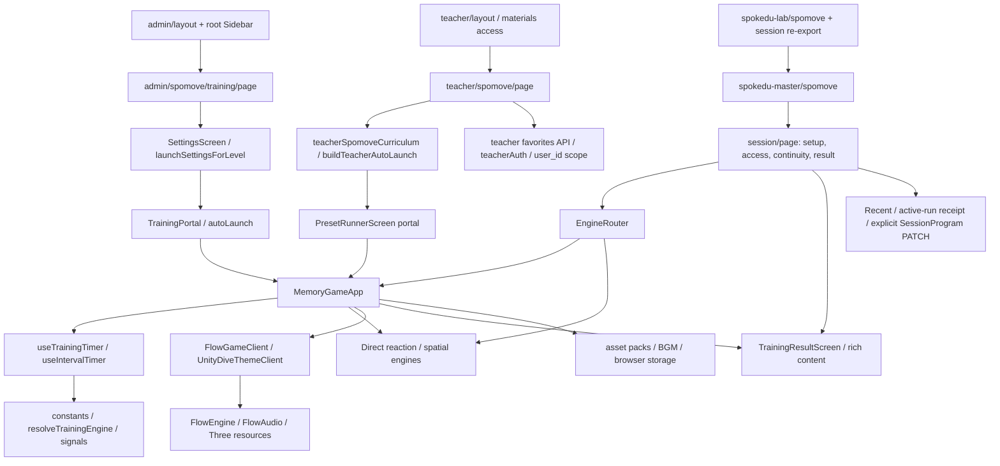

# SPOKEDU SPOMOVE — CODE FORENSIC AUDIT

감사일: 2026-10-30 (Asia/Seoul)

상태: **AUDIT_INCOMPLETE / FIX_NOT_STARTED**

범위: Admin Training · 공통 플레이어 · Teacher · MASTER/LAB · 연결된 인증/저장/미디어 경로.

## 1. 판정과 제한

제품 코드, CSS, DB, Git 이력, 배포를 변경하지 않았다. 감사 보고서, `.tmp/spomove-forensic-audit/`의 조사용 하네스, `artifacts/spomove-forensic-audit/`의 로컬 증거만 작성했다. 기존 개발 서버를 종료하지 않았다. 별도 dev 서버 시도는 기존 서버 감지로 종료되었으며 기존 서버를 이용했다.

**전체 전수검증 완료를 선언하지 않는다.** 아래 결과는 실제 로컬 Chromium 화면, 실제 소스 모듈을 사용하는 격리 브라우저 하네스, 정적 호출 추적, 기존 테스트를 구분한 중간 통합 감사 결과다. MASTER/LAB의 실제 인증·유료 플랜·기관 계정 E2E, 전체 내부 서브레벨과 난이도/옵션 조합, 자연 완료, 실물 모바일 브라우저 검증이 남아 있다. 해결되지 않은 P0가 없다는 보증도 아니다.

| 판정 | 의미 |
|---|---|
| CONFIRMED | 소스상 결함 또는 격리/화면 재현으로 입증. 각 항목에 증거 층위를 별도 표기 |
| LIKELY | 원인 후보가 구체적이나 사용자 경로/전체 증상 재현이 부족 |
| UNVERIFIED | 환경·계정·데이터·조합 검증이 남음 |
| FALSE POSITIVE | 재검증으로 최초 의심을 배제 |

P0는 무결성·보안·지속 저장의 중대 손상, P1은 주요 접근/실행/종료 실패, P2는 설정·표시·격리 결함, P3는 낮은 영향의 사용성 결함으로 사용한다. **P0 확인 건 없음**과 **P0 위험 없음**은 다르다.

## 2. 기준선과 보존

| 항목 | 값 |
|---|---|
| 작업 디렉터리 | `C:\Users\joker\Documents\GitHub\1` |
| 브랜치 | `main` |
| 감사 HEAD | `f18c1c61aad6c28818bd86c22b376a5bc995f73b` |
| 로컬 `origin/main` | 같은 SHA |
| 실제 원격 `refs/heads/main` | `git ls-remote origin refs/heads/main`으로 같은 SHA 확인 |
| 원격 | `https://github.com/spokedu77-ops/1.git` |
| Git 조작 | status/diff/rev-parse/ls-remote만 사용. fetch/stage/commit/push/branch/PR 없음 |
| 실행 환경 | Node `v24.15.0`, 설치된 Next `16.2.11`, 로컬 `127.0.0.1:3000` |

감사 시작 시 tracked 수정 26개와 untracked 작업 12개가 있었다. SPOMOVE 외 마케팅/센터/정산/운영 Provider 작업 등이 포함되었다. `AppShell.tsx`, `OperationalDataProvider.tsx`의 기존 변경도 그대로 둔 작업 트리를 기준으로 삼았다. HEAD만으로 모든 화면이 재현된다고 주장하지 않는다. 최초 상태는 도구 출력에, 종료 상태/내용 해시는 증거 폴더의 baseline/manifest에 기록한다. 최초 개별 파일 내용 해시까지 수집한 것은 아니므로 시간 중 다른 작업자의 변경까지 소급 보증하지 않는다.

읽은 권위 문서: `AGENTS.md` → `docs/SPOKEDU_MASTER_PRODUCT_CONTRACT.md` → `app/spokedu-master/MASTER_VISUAL_SYSTEM.md` → `MASTER_SURFACE_MATRIX.md` → `spomove/SPOMOVE_PRODUCT_CONTRACT.md`. 구현하지 않았으므로 Sprint Brief를 새로 승인하거나 제품 결정을 변경하지 않았다. 가격·권한·내비게이션의 새로운 SSOT를 만들지 않았다.

## 3. 조사 지도와 대상 수

증거: [정적 import 의존성 지도](artifacts/spomove-forensic-audit/dependency-map.json), [카탈로그 모드](artifacts/spomove-forensic-audit/mode-inventory.json), [내부 level·Teacher·공식 Preset 목록](artifacts/spomove-forensic-audit/extended-inventory.json).

| 집계 | 수 | 해석 |
|---|---:|---|
| 지정 디렉터리와 Admin/Teacher layout의 TS/TSX/CSS | 291 | 파일 목록화 대상. 모두 심층 읽기 완료라는 뜻 아님 |
| 로컬 import closure | 356 | alias/상대경로 정적 import 추출 |
| import edge | 1,093 | 함수 호출을 자동으로 모두 해석한 call graph 아님 |
| Admin 프로그램 / 카탈로그 테마 | 7 / 34 | 핵심 6개 + 하단 DIVE. `flow`는 핵심 slot 목록 밖에 별도로 렌더링 |
| `isKnownTrainingLevel` 허용 조합 | 57 | 아래 표. legacy ID 포함. 난이도/색 테마와 별개 |
| Teacher 커리큘럼 | 8주 / 33프로그램 | 실제 인벤토리 |
| MASTER 공식 Preset | 100 | 공개 표시/실행 가능 여부는 별도 gate의 영향을 받음 |

| mode | 카탈로그 테마 | 허용 내부 level 수 |
|---|---:|---:|
| reactTrain | 10 | 22 |
| basic | 8 | 10 |
| simon | 5 | 5 |
| flanker | 4 | 6 |
| stroop | 2 | 5 |
| spatial | 3 | 7 |
| flow | 2 | 2 |



추적한 경계 밖 의존성: `proxy.ts`, `app/layout.tsx`, `app/globals.css`, `components/Sidebar.tsx`, `providers/AppSidebarProvider.tsx`, `lib/constants/fullscreen-paths.ts`, `hooks/useTeacherMaterialsAccess.ts`, `lib/server/{adminAuth,teacherAuth,spokeduMasterAccess}.ts`, `lib/auth/adminCheckCache.ts`, `api/auth/check-{admin,teacher-materials}`, `api/institution/status`의 소비 경로, Teacher favorites GET/POST/DELETE, MASTER guide-video와 SessionProgram PATCH 소비 경로, asset hooks/storageClient/BgmPlayer, access model/route gate/trial helper. 실제 RLS 정책과 DB 상태 전체는 검증하지 않았다.

## 4. 검증 방법과 커버리지

로컬 Playwright의 **새 context / 쿠키 없음 / service worker 차단**을 사용했다. Admin 렌더링 테스트는 `/api/auth/check-admin`을 admin fixture로, Teacher 정상 렌더링은 materials allowed fixture로 대체했다. `/api/**` 응답은 fixture로 종료하고 외부 요청은 차단하거나 빈 asset-pack 응답으로 대체했다. 쓰기 요청이 운영 서버로 전달되지 않는다. CDN/원격 자산 차단 결과를 운영 에셋 고장으로 오판하지 않았다. 인증 fixture에서 화면을 볼 수 있다는 사실은 실제 서버 권한 PASS가 아니다.

기본 설정 폭: **320·360·390·430·768·1024·1280·1440·1920px**. 높이는 모바일 844, 나머지 900px. width 변경 뒤 400ms 대기하여 root shell의 300ms transition을 제거했다. 선택된 테마, DOM 텍스트, computed grid/flex, bounding rect, 화면 밖 요소, 44px 미만 버튼을 수집했다. 390/1440 스크린샷을 34테마별 저장했다. 가이드 및 844×390 가로 화면의 별도 결과는 아래 artifact에 기록한다.

| 검증 단위 | 전체 대상 | 실제 검증 | PASS | FAIL | 미검증 / 사유 |
|---|---:|---:|---:|---:|---|
| 기본 설정 화면의 가로 bounds | 34×9=306 | 306 | 306 | 0 | 0. 추가 옵션/가이드 상태 제외 |
| 기본 설정 화면의 버튼 44px bounds | 306 | 306 | 297 | 9 | 0. 모션 게이트 부록 41.5px |
| 같은 테마 메뉴의 열 수 불변성: Simon/Flanker/Spatial 비교 | 3쌍×9=27 | 27 | 0 | 27 | 0. F01 |
| 가이드 펼침 상태의 가로 bounds (390×844 / 844×390) | 34×2=68 | 68 | 68 | 0 | 동영상/이미지 원격 로딩은 차단. 높이/가림 전체 PASS 아님 |
| Admin 카탈로그 테마별 기본 실행 진입 | 34 | 34 시도 | 34 mount 관찰 | 0 mount 실패 | 선택한 신규/legacy variant의 의미 일치, 자연 완료·전체 시간은 별개 |
| 카탈로그 테마별 STOP/중지/나가기→결과→복귀 상태 전환 | 34 | 34 | 34 전환·overflow 복원 | 0 전환 실패 | 결과 의미는 F05/F06/F07 별도 FAIL. 초기 selector를 보완해 재수행 |
| 위 실행 단계 × 나머지 8개 폭 | 272 | 0 | 0 | 0 | 272. 기본 실행 sweep은 1440×900 |
| 자연 완료 전체 실행 | 최소 34 | 0 전체 세션 | 0 | 0 | 34. 짧은 STOP smoke로 완주 PASS를 대체하지 않음 |
| 허용 내부 level 경로 | 57 | 카탈로그 34테마 중심 | 전수 PASS 없음 | 일부 결함 확인 | 내부 ID·옵션 전체 일대일 실행 미완료 |
| Teacher 전체 프로그램 정상 흐름 | 33 | 1 | 전체 PASS 없음 | 재시도 scroll FAIL | 32프로그램 및 나머지 기능 미검증 |
| MASTER 공식 Preset 실제 인증 흐름 | 100 | 0 | 0 | 0 | 실제 계정/구독/fixture 데이터 미구성 |
| 실제 Free/Lite/Premium/기관/Admin 교차 권한 | 5계층 | 0 실계정 | 0 | 0 | 정적 gate 검토와 fixture만 수행 |
| 기존 단위·contract 테스트 | 76파일 / 753테스트 | 모두 | 753 | 0 | 실제 브라우저 의미 PASS 아님 |
| TypeScript 전체 | 1회 | 1 | 1 | 0 | `--incremental false`, 생성물 갱신 없음 |
| ESLint 감사 디렉터리 | 1회 | 1 | 1 | 0 | 0 errors / 0 warnings |
| Production Build | 1 | 0 | 0 | 0 | 기존 dev 서버의 `.next`와 충돌·build-time 외부 의존 영향이 격리되지 않아 미실행 |

**전체 시스템의 총 상태 조합 수는 아직 확정하지 못했다.** 57 level × 옵션 × 권한 × 9폭 × 생명주기를 306건으로 축소해서 표현하지 않는다. 모든 난이도 선택지/세부 옵션의 완전한 Cartesian 또는 위험 기반 제외 ledger도 미완성이다. 따라서 위 수는 지정된 각 검증 단위의 분모이며 전체 감사 완료율이 아니다.

증거:

- [설정 306건 JSON](artifacts/spomove-forensic-audit/settings-matrix.json)
- [가이드/가로 화면 JSON](artifacts/spomove-forensic-audit/guide-matrix.json)
- [Admin 실행·STOP sweep](artifacts/spomove-forensic-audit/runtime-sweep.json)
- [격리 타이머·스크롤·STOP·CSS](artifacts/spomove-forensic-audit/isolated-runtime.json)
- [storage fault injection](artifacts/spomove-forensic-audit/faults.json)
- [비로그인 Teacher fixture](artifacts/spomove-forensic-audit/teacher-no-session.json)
- [ESLint 원본](artifacts/spomove-forensic-audit/eslint.json)

## 5. 결함 목록

### F01 — 테마 선택에 따라 동일 메뉴가 1열↔2열 변경

**CONFIRMED · P2 · 실제 Admin DOM/computed style/스크린샷.**

- 위치: `app/admin/spomove/training/page.tsx:1047`, `:1084`, `:1102`, `:1242`.
- 재현: Simon 4번 랜덤 테마(internal 3) ↔ 5번 카모플라쥬(internal 4), Flanker 극단(internal 3) ↔ 다른 테마, Spatial 순간기억(7) ↔ 순서/랜덤기억을 선택한다.
- 기대: 같은 역할의 테마 선택 메뉴가 선택값 변경만으로 재배치되지 않는다.
- 실제: 390px에서 compact는 `display:grid`, `180.5px 180.5px`; 다른 선택은 `display:flex`, `gridTemplateColumns:none`. 9폭에서 동일 분기.
- 원인: 선택된 engine ID에 `compactSettingsMenu`를 결합해 메뉴 전체의 표현을 바꾼다. reactTrain은 모든 테마가 compact, basic은 모두 flex라 이 종류의 열 수 전환은 관찰되지 않았다.
- 영향: Admin 설정. 엔진 정답 로직 자체의 결함 증거는 아님.
- 증거: `settings-matrix.json`, `settings-simon-3-390.png`, `settings-simon-4-390.png`와 Flanker/Spatial 대응 파일.
- 최소 수정안/회귀 위험: 승인 후 메뉴 역할/반응형 기준으로 레이아웃 결정. 선택 ID·순서·설정 유지, 좁은 폭 label wrapping 회귀 확인.

### F02 — Teacher 재시도 후 스크롤 잠금이 영구 잔류

**CONFIRMED · P1 · 실제 Teacher 경로 재현 + 함수 하네스.**

- 위치: `app/teacher/spomove/page.tsx:2570`, `:3095`; `training/_player/lib/lockViewportScroll.ts:8`, `:18`; `components/TrainingResultScreen.tsx:198` 부근.
- 재현: Teacher → Spomove → 1주차 → 공간 방향 → STOP → 다시 실행 → STOP → 목록.
- 기대: 실행/결과를 떠나면 이전 document overflow로 복원.
- 실제: 목록에서 `body:'hidden', html:'hidden'`이 남음. 재시도 없는 Admin STOP→복귀는 빈 overflow로 복원되었다.
- 원인: onRetry의 수동 `lockViewportScroll()`은 대응 unlock이 없고, Runner와 결과 화면은 각각 hook으로 별도 잠근다. retry 횟수만큼 orphan ref-count가 남는다.
- 영향: Teacher 프로그램 실행 후 페이지 스크롤. 같은 window의 다른 경로에도 영향을 줄 수 있음.
- 증거: Teacher 실행 도구 출력과 `teacher-catalog-390.png`(재시도 복귀 화면), `isolated-runtime.json.scroll.orphan`; 조사 하네스 `teacher.cjs`에 정확한 순서 기록.
- 재실행 시 원본 측정은 `teacher-probe.json.scroll`에도 저장했다.
- 최소 수정안/회귀 위험: 승인 후 잠금 소유권을 mount lifecycle과 일치시키고 수동 중복 제거. portal 전환 중 순간 unlock, 결과 내부 스크롤을 함께 검증.

### F03 — force unlock이 기존 overflow 스타일을 복원하지 않음

**CONFIRMED · P2 · 실제 함수의 브라우저 하네스.**

- 위치: `training/_player/lib/lockViewportScroll.ts:28`; Admin `training/page.tsx:649`, `:3413`.
- 재현: html overflow=`scroll`, body=`auto`에서 lock 후 `forceUnlockViewportScroll()`.
- 기대: 저장한 원래 값 복원. 다른 소유자의 잠금도 부당하게 해제하지 않음.
- 실제: 두 값이 모두 `''`로 변경되고 ref-count=0. 정상 lock/unlock 쌍은 `scroll/auto`를 복원함.
- 원인: saved overflow를 사용하지 않고 빈 문자열 대입.
- 영향: 공통 모듈 사용자, Admin portal 종료. 다른 overlay와 겹칠 때 잠금 소유권도 무시.
- 증거: `isolated-runtime.json.scroll`.
- 최소 수정안/위험: 원래 값 및 실제 소유권 복원. F02 누수를 강제 해제로 덮지 말고 각각 처리.

### F04 — Teacher가 no-session 응답에도 콘텐츠·훈련을 렌더링

**CONFIRMED · P1 · 쿠키 없는 로컬 브라우저의 실제 응답 형식 fixture. 실서버 침투/DB 우회 판정 아님.**

- 위치: `app/hooks/useTeacherMaterialsAccess.ts:40` 부근; `app/teacher/layout.tsx:21`, `:99`; `app/api/auth/check-teacher-materials/route.ts:17`; `proxy.ts:143` 이후.
- 재현: institution status 401, materials 응답 `{allowed:false,reason:'no-session'}`. Teacher SPOMOVE 진입 후 1주차 공간방향 실행.
- 기대: 인증이 없으면 보호 자료/실행을 허용하지 않는다.
- 실제: 쿠키 없는 context가 Teacher 카탈로그를 열고 `REPS 14 / STOP` 런타임에 도달.
- 원인: hook은 `no-session`을 별도 state로 반환하지만 layout은 `denied`와 `loading`만 차단. proxy의 실제 인증 검사는 MASTER 보호 경로에만 적용되고 Teacher에는 최종 `NextResponse.next()`.
- 영향: Teacher 클라이언트 자료·로컬 엔진. favorites API는 별도 server auth가 있으므로 DB 읽기/쓰기 우회가 입증된 것은 아니다. Teacher와 MASTER의 플랜 계약은 구별해야 한다.
- 증거: `teacher-no-session.json`, `teacher-no-session-running.png`.
- 최소 수정안/위험: 승인 후 no-session을 명시 차단/재인증 처리하고 서버 entry gate 필요 범위 결정. 기관 리디렉션, active/inactive teacher, admin 예외 회귀.

### F05 — Admin/Teacher 중도 종료가 “훈련 완료·끝까지 완주”로 표시

**CONFIRMED · P1 · 실제 Admin STOP→결과.**

- 위치: `training/_player/MemoryGameApp.tsx:899`, `:1293`, `:3017`; `teacher/spomove/page.tsx:3081`; `lib/trainingResultRichContent.ts:58`, `:536`.
- 재현: 일반 basic 훈련 시작 후 첫 자극 부근 STOP.
- 기대: 중도 종료 표시, 실제 수행 분량/시간을 완료 성과와 구분.
- 실제: 약 1초 결과에 “훈련 완료”, “끝까지 완주했어요”, “차분하게 끝까지 해냈어요”가 표시됨.
- 원인: `endedEarly/stoppedEarly`는 내부에 저장해도 Admin의 `TrainingResultScreen`에 completionReason을 전달하지 않는다. Teacher preset result도 completionReason을 생략. 공통 rich content의 사실 기반 변환은 reason이 있을 때만 실행.
- 영향: Admin/Teacher 결과 의미. MASTER는 reason 전달 구조가 있어 같은 원인이라고 일괄 단정하지 않음. F06/F07은 MASTER로 전달되기 전 별개의 표지 손실.
- 정상 예외: Admin flow1 액션무브는 별도 `diveActionMove.completed` 경로로 “수업을 종료했습니다 / 중도 종료”를 표시했다. flow2와 generic 결과까지 이 예외를 확대하지 않는다.
- 증거: `runtime-sweep.json`의 basic 결과; `runtime-basic-result.txt` 계열; `MemoryGameApp`과 Teacher 호출부.
- 최소 수정안/위험: 종료 사유를 모든 결과 소비자까지 전달. 기존 결과·수업 활동 완료 저장을 소급 변경하지 말고 자연 완료/취소/에러를 별도 검증.

### F06 — 상대방향·조각찾기 STOP이 자연 완료 payload를 생성

**CONFIRMED · P1 · 실제 컴포넌트 격리 브라우저.**

- 위치: `components/RelativeCompassReactionTraining.tsx:85`; `components/ShapeCompletionReactionTraining.tsx:35`.
- 재현: 각 컴포넌트 targetRounds=10으로 mount, countdown 중 STOP 클릭.
- 기대: `stoppedEarly:true` 또는 onExit 경로, 정상 완료와 구분.
- 실제: 두 컴포넌트 모두 `onComplete({stims:0,maxCombo:0,laneCount:[0,0,0,0]})`, 중도 종료 표지 없음.
- 원인: `stop=()=>finish()`로 같은 종료 함수를 사용.
- 영향: Admin basic 7/8 신규 엔진, 이 컴포넌트의 다른 소비자. MASTER Router가 현재 이 신규 경로를 직접 실행한다고 가정하지 않음.
- 증거: `isolated-runtime.json.compass`, `.shape`.
- 최소 수정안/위험: STOP/자연 완료를 구별한 공통 종료 payload. 취소 중 async promise와 completion 중복도 확인.

### F07 — 공통 반응 엔진 adapter가 stoppedEarly를 버림

**CONFIRMED(소스 데이터 흐름) · P1 · 개별 모든 엔진 STOP의 실화면 전수 판정은 아님.**

- 위치: `MemoryGameApp.tsx:1332`의 `handleReactTrainComplete`; `:899`의 deliver; `session/EngineRouter.tsx:315` 부근.
- 재현 조건: `stats.stoppedEarly=true`인 반응 엔진이 MemoryGameApp의 handleReactTrainComplete를 호출.
- 기대: 전달 결과에도 중도 종료 유지.
- 실제: cfg/elapsed/counts만 전달하고 `{endedEarly:stats.stoppedEarly}`를 생략해 deliver 기본값 false. Router의 direct adapter는 이 값을 분기하지만 MemoryGameApp adapter는 손실.
- 원인/영향: 여러 반응 엔진의 shared wrapper 경로. MASTER의 direct branch와 wrapper branch가 다른 결과 의미를 갖게 됨.
- 증거: `VisualReactionTraining.tsx:669`의 stoppedEarly 생성 → `MemoryGameApp.tsx:1332` → `:905`; `stopResultPayload.contract.test.ts`는 문자열 존재만 검사.
- 최소 수정안/위험: adapter 의미 보존, 각 direct/embedded route에서 STOP과 자연 완료를 비교하는 통합 테스트.

### F08 — 반복 설정이 반응 엔진에 전달되지 않아 TIME 실행

**CONFIRMED · P1 · 실제 설정·실행 HUD + props 추적.**

- 위치: Admin `training/page.tsx:536`; `MemoryGameApp.tsx:2730`~`:2810`의 reaction JSX; `components/VisualReactionTraining.tsx`의 optional targetReps; MASTER `EngineRouter.tsx:430` 이후의 direct branch와 비교.
- 재현: reactTrain FLASH/RUSH/FLOW 등 반복 선택 가능한 테마에서 기본 반복 설정으로 실행.
- 기대: 설정한 반복 횟수에 맞춰 종료/HUD/결과 일치.
- 실제: 설정은 reps지만 실행 HUD가 `TIME 01:00`; wrapper는 `durationSec=settings.duration`만 전달하고 다수 엔진의 `targetReps`를 생략한다. Simon 풍선/카모도 같은 종류의 별도 JSX를 확인해야 함.
- 원인: 설정 모델은 reps로 갱신됐지만 runtime prop mapping이 time 기반으로 남음. MASTER direct router는 일부 대응 branch에 targetReps를 전달해 경로 간 차이가 명확.
- 영향: Admin의 해당 반복 테마. Teacher는 authored time 기반 프로그램도 있으므로 정상 time 실행을 같은 결함으로 취급하지 않음.
- 증거: `settings-reactTrain-3.txt`, `runtime-sweep.json` reactTrain 3/1/2, `run-reactTrain-3.png`.
- 최소 수정안/위험: 승인된 반복 단위(동시 자극 개수 포함)를 엔진별로 확정한 뒤 전달. 단순 duration 곱셈으로 대체하지 말 것. BONUS/round count 회귀 위험.

### F09 — 전역 player CSS가 부모 셸과 다른 요소에도 적용

**CONFIRMED · P2 · 실제 소스 CSS를 넣은 브라우저 하네스.**

- 위치: `training/_player/styles.ts:27`~`:44`; Teacher runner `page.tsx:2586`; Result `TrainingResultScreen.tsx:240`; MemoryGameApp의 여러 `<style>{CSS}</style>`.
- 재현: 플레이어 바깥 p 요소를 유지한 상태로 공통 CSS style을 mount.
- 기대: player reset/theme은 해당 player scope에 한정.
- 실제: 외부 p margin `16px 0px → 0px`; root `--bg:#F1F5F9` 전역 적용. `button:hover`, `button:active`에도 scope 없음.
- 원인: `:root`, `[data-theme]`, `*`, `body`, `button` 전역 selector를 portal 안 style로 삽입. portal 위치는 CSS scope가 아니다.
- 영향: player와 동시에 mount된 Admin/Teacher/MASTER shell, 결과 화면과 overlay. style 노드 제거 뒤 CSS 자체가 계속 남는다고 주장하지 않음.
- 증거: `isolated-runtime.json.css`.
- 최소 수정안/위험: wrapper scope 또는 shadow/명시적 토큰 정책. body scroll/theme과 popup portal target을 별도로 처리해야 하며 단순 prefix 추가로 portal 자식이 빠질 수 있음.

### F10 — html data-theme 변경을 종료 시 복원하지 않음

**CONFIRMED(소스 + 복귀 DOM) · P2.**

- 위치: `MemoryGameApp.tsx:548`, `:616`~`:619`.
- 재현: player 실행 후 결과→목록.
- 기대: 문서 전역 theme 소유자가 아니라면 진입 전 attr 복원.
- 실제: `documentElement data-theme='light'`가 복귀 뒤에도 남음. effect cleanup 없음. theme storage 접근도 try/catch가 없음.
- 원인/영향: player가 전역 document attribute를 직접 소유하고 반납하지 않음. 다른 화면의 `[data-theme]` selector와 상호작용 가능. 모든 다른 화면이 실제로 색상 변형된다는 증거는 아님.
- 증거: runtime 복귀 DOM 출력, `runtime-sweep.json` restored 필드.
- 최소 수정안/위험: 전역 theme 소유권 정리 또는 previous attr 복원. 사용자 저장 테마 의미를 임의 변경하지 않음.

### F11 — Shape Completion(8)이 Relative Compass(7) 안내로 표시

**CONFIRMED · P2 · 실제 Admin 설정 화면.**

- 위치: `constants.ts:322`, `:332`; `training/page.tsx:122`, `:277`, `:1239`.
- 재현: basic → 8번 맞는 조각 찾아가기 선택.
- 기대: 헤더·guide·현재 테마가 8번 조각찾기와 일치.
- 실제: 선택 버튼과 새 설정은 조각찾기인데 헤더/guide/current theme은 “7번 내 자리에서 방향 따라가기”. 조각찾기 런타임 자체는 진입 확인.
- 원인: 신규 ID 7/8과 legacy modified-quadrant 7~10의 의미 충돌. `catalogBasicUiLevel(8)`이 7을 반환하며 label 함수는 feature flag를 보지 않음. 결과의 legacy `resultLevelLabel`도 동일 충돌 추적 필요.
- 영향: Admin 안내/결과 이름, legacy Teacher 커리큘럼의 설명 매핑. legacy 엔진을 임의 삭제하면 회귀.
- 증거: `settings-basic-8.txt`, `settings-basic-8-390.png`, `runtime-sweep.json` basic 8.
- 최소 수정안/위험: 신규 variant와 legacy level의 식별 모델/label discriminator를 명시. 저장된 level 8의 의미 변경 금지.

### F12 — 상대방향 응답 시간에 시작 시간을 전달

**CONFIRMED(소스) · P2 · 서로 다른 값의 사용자 화면 재현은 UNVERIFIED.**

- 위치: `training/page.tsx:700`~`:701`; 비교 `:510`~`:511`, `MemoryGameApp.tsx:815`~`:819`.
- 조건: launch의 startSeconds와 responseSeconds가 다름.
- 기대/실제: responseSeconds를 전달해야 하지만 startSeconds가 대입됨.
- 원인: TrainingPortal의 복사 mapping 오류.
- 영향: Admin launch/복원 경로. 현 UI `page.tsx:2220`은 두 값을 함께 갱신하므로 일반 slider 동작만으로 차이를 재현했다고 주장하지 않음. 저장/별도 consumer에서 값이 갈릴 때 발현.
- 증거: 두 필드의 정상 읽기/저장과 launch mapping 비교.
- 최소 수정안/위험: 대응 필드 전달 및 서로 다른 두 값의 adapter 테스트. 하나의 slider를 둘로 바꾸는 제품 결정은 별개.

### F13 — 실제 문자열 literal/JSX 5곳 손상

**CONFIRMED(UTF-8 AST) · P2 · 실제 TTS 청취/해당 모든 버튼 화면 재현은 UNVERIFIED.**

- 위치: `MemoryGameApp.tsx:925`, `:1170`, `:1190`, `:2415`, `:2444`.
- 조건: voice mode의 시작/완료, 구 player 설정의 해당 버튼 노출.
- 기대: 읽을 수 있는 문구/음성.
- 실제: `?????` 반복 및 깨진 코드포인트가 실행 문자열에 들어 있음. PowerShell 기본 디코딩 화면만으로 판정하지 않고 UTF-8 parser로 comment를 제외하고 5개 literal/JSX를 추출했다.
- 원인: 저장된 소스의 문자열 손상. 정확한 원문은 현재 코드에서 추정 복원할 수 없음.
- 영향: 공통 player 소비 경로. 주석의 대량 손상은 별도 runtime 결함 수에 포함하지 않음.
- 증거: [손상 문자열 AST 목록](artifacts/spomove-forensic-audit/damaged-strings.json).
- 최소 수정안/위험: 승인된 원문/정상 과거본 대조 후 해당 문자열만 복원. 임의 카피 작성이나 전체 파일 인코딩 재저장 금지.

### F14 — storage 읽기 차단 시 모든 Admin 설정 화면 붕괴

**CONFIRMED · P1 · 실제 Admin fault injection.**

- 위치: `lib/flowPresets.ts:87`~`:93`; Admin `training/page.tsx:995`; MemoryGameApp `:548`, `:584`, `:618`.
- 재현: `Storage.getItem('spomove_flow_presets...')`가 SecurityError를 던지도록 격리 context에서 차단 후 basic 설정 열기.
- 기대: 저장 프리셋 없이 설정/실행 가능하거나 명시적인 저장 불가 상태.
- 실제: “화면을 불러오지 못했습니다” 오류 boundary. 새로고침만으로 persistent storage 제한은 해결되지 않음.
- 원인: Flow 외 모드도 공통 SettingsScreen initializer에서 uncaught getItem 호출. JSON parsing의 catch는 storage read 예외를 덮지 못함.
- 영향: Admin 모든 설정; player theme/preset에서도 유사 uncaught storage 경로.
- 증거: `faults.json` blocked-presets, `fault-blocked-presets.png`.
- 최소 수정안/위험: read/migration 경계를 보호하고 저장 실패와 실제 저장 성공을 구별. 빈 배열로 조용히 durable save 성공을 가장하지 말 것.

### F15 — 손상된 학생 저장 데이터가 STOP 결과를 붕괴시킴

**CONFIRMED · P1 · 실제 Admin fault injection.**

- 위치: `lib/storage.ts:7`~`:10`; `hooks/useStudents.ts:11`; `MemoryGameApp.tsx:3019`.
- 재현: 격리 localStorage `spokedu_students_v1='{}'` → basic 시작 → STOP.
- 기대: 잘못된 로컬 데이터는 격리/복구하여 결과 진입 유지.
- 실제: 실행은 시작하지만 결과에서 전체 오류 boundary로 전환.
- 원인: JSON.parse 결과를 배열/row schema 검증 없이 반환하여 `students.find` 등 배열 연산이 실패. JSON 문법 오류만 catch됨.
- 영향: 공통 player의 로컬 학생 데이터와 결과. 계정/tenant별 저장 키 분리도 별도 검토 필요하나 유출을 실증한 것은 아님.
- 증거: `faults.json` corrupt-students, `fault-corrupt-students.png`.
- 최소 수정안/위험: schema 검증 및 손상값 비파괴 복구 정책. 기존 학생 기록 삭제/키 migration은 별도 승인 범위.

### F16 — 순간기억 결과의 격자·분량이 실제 설정과 다름

**CONFIRMED · P2 · 실제 실행/결과 + 소스.**

- 위치: `MemoryGameApp.tsx:2685` 부근; `lib/trainingResultSummary.ts:48`; `lib/trainingResultRichContent.ts:544`~`:546`.
- 재현: spatial 순간기억 기본 4×4 실행 후 STOP.
- 기대: 실행한 4×4 및 실제 작성/선택 라운드 수를 결과에도 표시.
- 실제: 설정은 4×4와 “훈련 시간 1분”을 노출하지만 runtime은 `ROUND 1 / 20`, 결과는 “격자 3×3”, “10라운드”로 서로 다른 실행 분량/격자를 표시한다. wrapper는 gridSize 4와 targetReps 20을 전달하지만 result cfg에는 격자가 없고 rich content는 제목에 `4X4/4×4`가 있는지로 추측. spatial 분량은 `MEMORY_ROUNDS` 상수로 고정. 시간 선택 UI와 round 기반 엔진의 관계도 함께 수정 범위로 확정해야 한다.
- 영향: Admin 순간기억, 제목/별도 volumeLabel 없는 공통 결과 소비자. Teacher authored 4라운드 등의 결과도 동일 상수 경로를 검토해야 함. MASTER는 별도 제목/volume override가 있어 무조건 동일 실패로 분류하지 않음.
- 증거: `run-spatial-7.png`, `runtime-sweep.json` spatial7 resultText, `settings-spatial-7.txt`.
- 최소 수정안/위험: 실제 실행 config의 grid/round를 결과 모델로 전달. 제목 parsing 제거는 승인 후 수행. 과거 기록은 변경하지 않음.

### F17 — fullscreen 요청 중복, 일부 exit rejection 미처리

**CONFIRMED(중복 요청) / LIKELY(일부 실패 영향) · P2.**

- 위치: Admin `training/page.tsx:3267`; `MemoryGameApp.tsx:1023`~`:1056`, `:917`, `:1273`, `:1308`, `:1335`.
- 재현: requestFullscreen을 reject시키고 일반 basic 시작.
- 기대: 하나의 명시 사용자 제스처에서 요청, 실패 시 정상 viewport 실행/정리.
- 실제: 한 시작에서 request가 2회 관찰됨. 시작 버튼 요청 뒤 screen effect RAF에서 다시 요청. 거절 상태에서도 basic 실행·STOP·복귀는 가능했다.
- 원인: fullscreen 소유권이 부모 start와 내부 screen effect에 분산. 다수 exit는 Promise catch 없음.
- 영향: Admin. MASTER는 별도 catch wrapper가 있어 구분 필요. iOS/ESC/브라우저 exit rejection의 실제 영향은 미검증.
- 증거: runtime probe의 `fullscreen:['request','request']`, 코드의 catch 유무 비교.
- 최소 수정안/위험: 단일 fullscreen 제어 경계, user activation, 실패·ESC·종료 cleanup 계약 정리. 모바일 호환을 근거 없이 PASS하지 않음.

### F18 — 마지막 반복 자극 직후 같은 RAF에서 완료

**LIKELY · P1 · 실제 hook 브라우저 재현, 최종 자극의 paint/인지 가능 시간은 추가 검증 필요.**

- 위치: `hooks/useTrainingTimer.ts:207`, `:225`; `lib/repsLogic.ts:30`.
- 재현: 실제 hook에 0.1초×10회를 주고 signal/finish 시각 수집.
- 기대: 마지막 자극도 설정된 반응/노출 기회를 가진 뒤 완료.
- 실제: 10번째 signal 약 1106.7ms, finish 약 1107.0ms. 최종 onSignal과 onFinish가 같은 tick에서 발생한다. MemoryGameApp에서는 signal 표시와 result 전환이 같은 React batch가 될 수 있음.
- 원인: presented count 증가 직후 finish. elapsed로 다음 자극 간격이 지나기를 기다리지 않음.
- 영향: shared generic repetition timer, Admin/Teacher/MASTER wrapper. 실제 마지막 프레임 누락의 전수 screen capture는 안 했으므로 CONFIRMED 사용자 증상으로 승격하지 않음.
- 증거: `isolated-runtime.json.timer`.
- 최소 수정안/위험: count의 의미(제시/응답 기회 종료) 승인 후 마지막 노출 종료를 모델링. 전체 예상 시간·progress·accel·interval에 회귀 위험.

### F19 — pause 플래그가 일반 clock/timer를 정지하지 않음

**LIKELY · P2 · 모듈 동작은 재현, 현 사용자 진입 경로는 미확정.**

- 위치: `lib/runtimeClock.ts:6`, `:20`, `:38`~`:65`; `session/EngineRouter.tsx:295`; `session/page.tsx:865`, `:1197`.
- 조건: runtimeState를 paused로 전환하는 소비자가 활성화될 때.
- 기대: 경과시간·timeout·RAF·반복 진행이 동결되고 재개 시 남은 양 유지.
- 실제: pause=true 뒤에도 8개 signal과 finish 발생. now/timeout/RAF wrapper는 native API를 그대로 호출. 일부 audio만 pause 구독.
- 근본 원인/영향: pause flag와 clock 구현이 분리. 다만 현재 session/page에는 paused UI/재개 코드가 있어도 일반 사용자가 running→paused로 진입하는 setter를 찾지 못했으므로 **현재 사용자가 일시정지를 눌렀는데 실패했다고 보고하지 않는다.** dormant 경로·향후 소비자 위험.
- 증거: `isolated-runtime.json.timer`, pause symbol 전역 caller search.
- 최소 수정안/위험: 실제 pause capability 유지 여부를 제품 결정과 대조한 뒤 시간축 계약 검증. 단순 flag 검사 추가로 timer 유실을 만들지 말 것.

### F20 — 모션 게이트 부록 버튼이 44px 미만

**CONFIRMED · P3 · 실제 9폭 bounding rect.**

- 위치: `components/ColorGatePoseAppendix.tsx:247` 부근; Admin `page.tsx:1107`.
- 재현: flow2 설정의 닫힌 부록 toggle.
- 기대/실제: 44px 이상 정책 대비 높이 41.5px. 9폭 동일.
- 원인: 자식 컴포넌트 버튼의 padding/line-height. 부모 scoped styled-jsx의 button selector가 모든 자식 내부 DOM에 적용된다고 가정할 수 없음.
- 영향/증거: Admin flow2 기본 설정; `settings-matrix.json.smallButtons` 9건.
- 최소 수정안/위험: 자식 버튼의 명시 min-height. 부록 펼침/전체화면 버튼도 함께 실측.

## 6. 배제한 의심과 미확인 사항

| ID | 판정 | 내용 |
|---|---|---|
| X01 | FALSE POSITIVE | 초기 빠른 viewport 변경에서 bounds 초과 30건이 나왔으나 셸 transition 안정화 400ms 후 306건 모두 bounds 정상. 최초 수치를 제품 결함으로 사용하지 않음 |
| X02 | FALSE POSITIVE | compact CSS의 `min-height:31px`만 보고 전체 compact 버튼이 31px라고 판단할 수 없음. 부모 native button의 `44px !important`가 적용됨. 실제 미달은 F20 자식 버튼 |
| X03 | FALSE POSITIVE | 숫자 기차와 Flow의 STOP 영문 버튼 미검출은 실행 실패 증거가 아님. 실제 이름은 `중지`, `✕ 나가기`; selector 보완 |
| X04 | UNVERIFIED | sweep의 basic7에서 상대방향 대신 generic stimulus가 잡히고, 단독 재현에서는 실제 RelativeCompass 컴포넌트가 확인됨. 300ms 안정화/initialLevel 대조 뒤에도 feature flag와 실제 엔진 의미 일치까지 해결하지 못했다. localStorage·이전 실행·선택 경합·asset 응답을 분리하는 추가 재현 필요. basic7 실행 의미 PASS나 deterministic 근본 원인을 주장하지 않음 |
| X05 | UNVERIFIED | 100 Preset의 Free/Lite/Premium/기관 권한 우회, private media signed URL, 실제 RLS/tenant 격리. 정적 gate 존재와 실서버 보장은 별개 |
| X06 | UNVERIFIED | 실제 iOS fullscreen, ESC/뒤로가기/새로고침, 네트워크 복구, 오디오 autoplay, 모바일 safe-area/키보드/200% 확대 전체 조합 |
| X07 | UNVERIFIED | 장시간 RAF/listener/audio/GPU 메모리 안정성. cleanup 존재를 heap leak 부재로 판정하지 않음 |
| X08 | UNVERIFIED | Teacher favorites count→insert 경쟁 조건과 payload 범위 검증. DB 제약/실제 동시성 확인 없이 확정하지 않음 |

## 7. 정상 확인 범위와 교차 영향

| 영역 | 실제 확인 | 제한 |
|---|---|---|
| Admin 기본 설정 | 34테마·9폭의 DOM/computed/bounds 수집, 390/1440 캡처 | 전체 시각적 PASS 아님. 실제 이미지 데이터가 빈 fixture |
| Admin 기본 실행 | 34테마 진입 시도, STOP/결과/복귀 추적 | authored 자연 완료·모든 난이도·지속 실행 미완료 |
| 스크롤 모듈 | balanced lock/unlock은 이전 `scroll/auto` 복원 | retry orphan/force는 FAIL |
| 일반 타이머 | effect cleanup에서 RAF cancel/TTS clear 존재 | 최종 자극 노출과 실 pause에는 별도 문제 |
| Interval timer | effect cleanup 및 마지막 work 후 종료 분기 정적 확인 | frame throttling·background·zero rest 전수 재현 안 함 |
| Flow | resize/context-lost listener, generation guard, dispose 경로 정적 확인 | 실제 Unity/Three 에셋 완전성, GPU 회수/오디오/자연 완료 미확인 |
| DIVE 액션무브 STOP 결과 | flow1은 실제 “중도 종료” 표시 | 공통 결과의 완료 오표시 F05에 포함되는 flow2와 구별 |
| Teacher favorites | GET/DELETE 모두 auth.userId 조건, POST 서버에서 userId 고정 | DB 정책/동시 insert 한도/운영 데이터 검증 아님 |
| MASTER SessionProgram 완료 | finishSession이 자동 isCompleted PATCH 하지 않고 명시 CTA에서 PATCH | 실계정 persistence/오류회복 미확인 |
| MASTER guide-video | preset 유효성 + 서버 preset access + private no-store + signed URL 경계 존재 | 실제 entitlement·bucket 정책/서명 검증 아님 |

Admin/Teacher는 공통 MemoryGameApp을 통과하는 범위가 넓다. MASTER는 EngineRouter에서 직접 엔진을 mount하는 branch와 MemoryGameApp branch가 섞여 있다. 따라서 같은 테마 이름이라도 props·종료 payload·시간 계산·소리·전체화면을 각각 비교해야 한다. LAB의 두 페이지는 MASTER 구현을 re-export하므로 같은 구현 결함을 공유할 수 있지만, route base·layout·access provider는 실제 LAB 경로에서 다시 확인해야 한다.

## 8. 기존 테스트의 사각지대와 추가 설계

실행한 명령:

```text
node node_modules/vitest/vitest.mjs run app/admin/spomove/training/_player app/spokedu-master/spomove app/lib/spomove
→ Test Files 76 passed; Tests 753 passed
node node_modules/typescript/bin/tsc --noEmit --incremental false --pretty false
→ exit 0
node node_modules/eslint/bin/eslint.js app/admin/spomove app/teacher/spomove app/spokedu-lab/spomove app/spokedu-master/spomove app/lib/spomove --format json --output-file artifacts/spomove-forensic-audit/eslint.json
→ exit 0; errors 0; warnings 0
```

`spomove.test.ts:6`~`:13`도 React 생명주기·canvas·실제 fetch를 검증하지 못한다고 명시한다. 여러 contract 테스트는 `readFileSync(...).toContain(...)` 방식이어서 stoppedEarly 문자열, unlock 문자열, fullscreen catch가 다른 위치에 존재하면 의미 손실을 검출하지 못한다. 753 PASS와 위 결함은 모순이 아니다.

승인 후 필요한 회귀 테스트:

1. **권한**: fresh/no-session/inactive/active/admin/institution 상태를 layout+API 응답으로 결합하고 보호 콘텐츠 DOM/실행 mount 부재를 검증. Free/Lite trial/Premium은 별도 server access fixture와 실제 격리 계정으로 검증.
2. **설정→엔진 adapter**: 모든 catalog level과 legacy level, feature flag, 반복값 10/15/20/30, start≠response 시간을 실제 mounted engine props로 검증. 시간/반복 fallback을 분리.
3. **종료 의미**: 자연 완료/STOP/초기 취소/오류별 terminal payload→Router→결과→Recent/receipt를 검증. “끝까지” 카피와 isCompleted 쓰기가 잘못 발생하지 않아야 함.
4. **잠금 소유권**: 3회 retry→목록→다른 route, nested modal, 원래 overflow scroll/auto/hidden, StrictMode mount/unmount에서 문서 스타일 복원.
5. **시간축**: 실제 hook+browser의 마지막 stimulus paint·duration, accel, interval, tab background. pause가 제품 기능이라면 freeze/resume을 실시간 제어로 검증.
6. **CSS/시각**: populated asset fixture의 34테마×전체 난이도, 9폭·짧은 높이·가로 화면·확대. 공통 메뉴 열 수, guide 펼침, CTA 접근성, z-index hit testing. screenshot existence만으로 PASS하지 않음.
7. **저장/에셋 실패**: getItem/setItem SecurityError/QuotaExceededError, malformed JSON/틀린 schema, 404 이미지·BGM·WebGL loss, stale async response. 성공 UI와 durable 저장을 대조.
8. **성과 표시**: 3×3/4×4/5×5, authored 4/5/10 rounds가 runtime·결과·재실행에서 일치. 제목 문자열로 실제 config를 추론하지 않음.

감사용 하네스는 제품 테스트 suite에 추가하지 않았다. 사용자 승인 없이 회귀 테스트나 제품 코드를 고치지 않았다.

## 9. 우선순위와 승인 단계

| 단계 | 우선 대상 | 승인 후 최소 범위 | 회귀 위험 |
|---|---|---|---|
| A | F04 | Teacher no-session gate와 대응 auth E2E | 기관·관리자·로그인 복귀 |
| B | F02/F03/F14/F15 | scroll 소유권, 안전한 storage read/schema 경계 | portal 전환, 기존 로컬 데이터 보존 |
| C | F05/F06/F07/F08 | 종료 사유 adapter와 반복량 전달 | natural/early/cancelled 의미, 동시 자극 단위, 기존 기록 |
| D | F11/F12/F16 | legacy/new variant 식별·시간·실제 결과 config | 저장된 level 의미와 Teacher authored curriculum |
| E | F01/F09/F10/F13/F17/F20 | 설정 레이아웃·스타일 격리·문구·fullscreen | 각 portal와 mobile layout, 사용자 테마 |
| 별도 결정 | F18/F19 | 마지막 노출 종료 의미, 실제 pause capability 계약 | 실행 시간/리듬/연속성 보호 필요 |

각 단계의 승인 대상은 구체적인 파일 범위·동작 변경·필요한 표적 테스트·미변경 데이터 계약을 담은 별도 수정 Brief다. **이 표는 구현 승인이 아니다.** 현재 발견 사항 수정은 시작하지 않았다.

## 10. 감사 종료 조건의 남은 항목

전체 난이도·세부 옵션 inventory/제외 ledger 확정, 57 내부 level과 100 Preset/33 Teacher 프로그램의 대응표, populated 로컬 에셋, MASTER/LAB 실제 인증 fixture, 전체 자연 완료와 재실행·복귀, 모바일/가로/확대/실패·ESC·뒤로가기/새로고침, persistence 격리 DB 검증과 장시간 누수 측정이 필요하다. 이 항목들이 남은 동안 **AUDIT_COMPLETE로 승격할 수 없다.**

**최종 상태: AUDIT_INCOMPLETE / FIX_NOT_STARTED**
