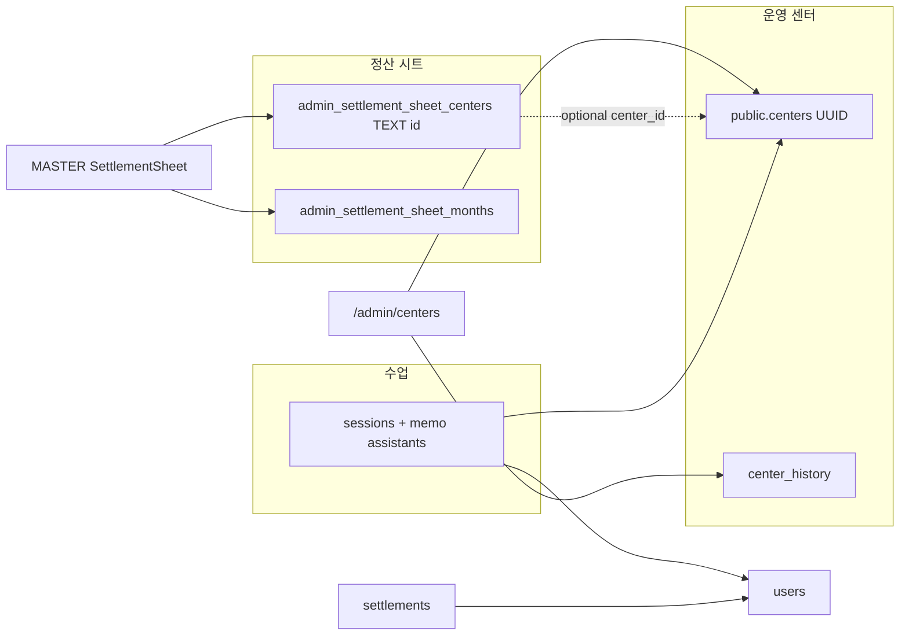

# 01. CENTER_SETTLEMENT_CODE_AUDIT

**범위:** `/admin/centers`, 정산 시트(MASTER), 레거시 `settlements`  
**실측 DB:** 로컬 `.env.local`이 가리키는 Supabase 프로젝트 (`mwgvserdyflsqyhcqecp`), service role read-only 스크립트  
**판정:** 감사 완료 (구현 미착수)

---

## 1. 확인한 사실 (코드 + DB)

### 1.1 센터 관리 UI·서버

| 계층 | 경로 | 역할 |
|------|------|------|
| 목록 RSC | `app/admin/centers/page.tsx` | `getCenters({ status: 'active' })` → `CentersHubClient` |
| 허브 탭 | `app/admin/centers/CentersHubClient.tsx` | `목록` / `센터 미정 캘린더` (후자는 **DB 무관**) |
| 목록 클라이언트 | `app/admin/centers/CentersClient.tsx` | 필터·검색·모달 오픈 |
| 상세 모달 | `app/admin/centers/components/CenterDetailModal.tsx` → `[id]/CenterDetailClient.tsx` | 단일 상세 UI (풀페이지 `[id]/page.tsx`와 공유) |
| 서버 액션 SSOT | `app/admin/centers/actions/centers.ts` | CRUD, `getCenterById`, `getActiveTeachers` |
| 운영 기록 | `app/admin/centers/actions/center-history.ts` | `center_history` 테이블 |
| 타입 | `app/lib/centers/types.ts`, `app/lib/centers/schemas.ts` | `session_fee`, `main_teacher_*`, `instructors_default` |

**데이터 원본:** PostgreSQL `public.centers` (+ `public.center_history`).  
**접근:** 모든 센터 액션은 `requireAdmin()` 후 **`getServiceSupabase()` (service_role)** — RLS 우회, UI 권한만으로는 부족 (`CENTER_QUERY_AUDIT.md` §권한).

**REST/Route Handler:** 센터 전용 HTTP API는 없음. Next.js Server Actions만 사용.

### 1.2 `session_fee` 의미

- 마이그레이션: `sql/archive/legacy/55_centers_add_session_fee_and_main_teacher.sql` — **회당 수업료**, nullable integer, ≥0.
- 센터 상세·수정: `centers.session_fee`에 저장 (`CenterDetailClient.tsx` 편집 → `updateCenter`).
- 정산 시트: **별도 필드** `SettlementCenter.fee` / 월별 row `fee` (표현식 가능). `SettlementCenterLink`는 운영 센터의 `session_fee`를 **참고 표시만** (`app/admin/master/reports/SettlementCenterLink.tsx` L61).
- **센터 청구 수업료와 정산 시트 fee는 자동 동기화되지 않음** (설계상 독립).

### 1.3 `main_teacher_id` / `main_teacher_2_id` / `main_teacher_3_id`

- `main_teacher_id`: 최초 메인 강사 FK → `users.id` (`ON DELETE SET NULL`).
- `main_teacher_2_id`, `main_teacher_3_id`: `supabase/migrations/20260425120000_centers_main_teachers_contact_history.sql` — 주석 **「메인 강사 2/3」**, FK 동일.
- UI 라벨: 상세 카드 **「메인 1/2/3」** (`CenterDetailClient.tsx` L754–763).
- **보조 강사:** UUID FK가 아님. `instructors_default.backup`은 **이름 문자열 배열**; `sub`는 저장 시 **항상 null** (`CenterDetailClient.tsx` L523–524). 수업 런타임 보조는 `sessions` + memo 파싱 (`ClassBundlePanel.tsx` 등) — 센터 JSON과 별계.

### 1.4 정산 시트 시스템

| 테이블 | PK | payload |
|--------|-----|---------|
| `admin_settlement_sheet_centers` | **TEXT** `id` | JSONB — `SettlementCenter` (`settlementSheetCore.ts`) |
| `admin_settlement_sheet_months` | `month_key` | 월별 `rows[]`, `locked`, revision |
| `admin_settlement_sheet_settings` | singleton | VAT 방식 등 |

- 스키마: `supabase/migrations/20261026120000_admin_settlement_sheet.sql`
- API: `app/api/admin/settlement-sheet/route.ts` — **MASTER_EMAIL** only; GET/PUT; locked month **423**; revision **409**
- UI: `app/admin/master/reports/SettlementSheet.tsx` + `settlementSheetCore.ts`
- 운영 센터 연결: payload optional **`center_id` (UUID)** — PUT 시 `centers` 존재 검증 (L95–99). UI: `SettlementCenterLink.tsx` + `GET /api/admin/settlement-centers`

**JSON 필드 (정산 센터 policy payload):**

| 필드 | 타입/역할 | 계산·사용 |
|------|-----------|-----------|
| `fee` | string/number | `centerFee()` — instr/assist/rental 양수 있으면 `a+b+c`, 아니면 fee (`settlementSheetCore.ts` L98–101) |
| `instr` | string/number | 주강사료(정책); `rates[]`로 월별 override |
| `assist` | string/number | 보조 강사료(정책) |
| `rental` | string/number | 교구 대여 |
| `cost` | string/number | 비용; row에 `cost*회기` |
| `rates` | `{ from, instr, assist, rental, cost }[]` | `rateFor()` — monthKey 이하 최신 from 적용 |
| `sessions` | string/number | 월 row 생성 시 회기 수 seed |
| `vat` | `'auto' \| 'none'` | row vatMode |
| `whRate` | number | 원천징수율 % → `calculateRow` |
| `center_id` | UUID optional | **운영 `centers.id` 링크** (정산 TEXT id와 별개) |

**월별 row:** `rowFromCenter()` — policy에서 fee/cost/sessions/vat/whRate/dueDate/type 복사; 금액 계산은 `calculateRow()` / `evaluateExpression()` (회기 변수 `C`/`N`).

### 1.5 레거시 `settlements` (83행 실측)

- 정산 **시트와 별도** 테이블. 코드 참조:
  - `app/admin/master/reports/TeacherSettlementReport.tsx` — 강사 정산 UI
  - `app/api/teacher/settlement-sessions/route.ts` — 강사 포털
  - `app/api/admin/teachers/sync-by-email/route.ts` — `teacher_id` 갱신
- 센터 UUID와 직접 FK 연결은 이번 코드 추적 범위에서 **시트 payload `center_id`와 무관**.

### 1.6 `centers` 테이블 0건 vs 관리자 UI 표시 — 규명

**실측 (동일 프로젝트 ref, service role, 2026-10-30):**

| 지표 | 값 |
|------|-----|
| `public.centers` 전체 | **52** |
| `status = active` | **19** (목록 기본 필터와 일치) |
| `admin_settlement_sheet_centers` | **59** |
| payload `center_id` → operational centers | **0** |

**UI가 센터를 보여주는 이유:** `page.tsx`가 service role로 `centers`를 읽기 때문. **0건이면 목록은 빈 배열** (catch 시 `[]`).

**「0건」 관측과 양립 가능한 원인 (우선순위):**

1. **다른 Supabase 프로젝트/브랜치** — Dashboard SQL Editor, anon key, Preview env가 `.env.local`과 다름.
2. **다른 테이블 혼동** — `spokedu_pro_centers` (SPOKEDU PRO, `20260308000000_spokedu_pro_commercial.sql`) vs 운영 `public.centers`.
3. **필터/스키마** — `public`이 아닌 스키마, 또는 `status`/RLS로 **authenticated**만 0건 (앱은 service_role 사용).
4. **정산 59건과 혼동** — 정산 policy id는 TEXT; `centers` UUID 테이블과 별개.
5. **「센터 미정 캘린더」탭** — `localStorage` key `center-tbd-calendar-v2` (`app/admin/centers/lib/localTbdStorage.ts`); **DB rows 아님**.

**결론:** 코드 경로상 센터 목록 SSOT는 **`public.centers`**. 로컬 앱 env 기준 DB에는 데이터가 있음. 0건 보고는 **환경/테이블/키 불일치**로 설명하는 것이 타당하며, **빈 DB 가정으로 seed/DDL 금지** (지시서 §2.A).

### 1.7 센터 삭제·정산

- `deleteCenter`: `centers` row만 DELETE. 정산 policy·월별 row **자동 삭제/해제 없음**.
- 정산 `center_id` 연결 해제: 시트 PUT으로 payload에서 UUID 제거 가능; **과거 월 row의 `centerId`(TEXT policy id)는 유지**.

### 1.8 확정 월 보호

- `admin_settlement_sheet_months.locked = true` 이면 payload 변경 및 lock 해제 전 수정 **423** (`settlement-sheet/route.ts` L76–77).
- restore 경로도 확정 월 덮어쓰기 방지 (동 파일 하단).

---

## 2. 재사용할 요소

- `app/admin/centers/actions/centers.ts` — CRUD·히스토리·service_role 패턴
- `app/api/admin/settlement-sheet/route.ts` + `settlementSheetCore.ts` — 정산 SSOT
- `SettlementCenterLink` + `settlement-centers/route.ts` — UUID 연결 UX·검증 **이미 존재**
- `payload.center_id` 필드 — **스키마 migration 없이** 연결 가능 (JSON 확장)

---

## 3. 발견한 결함·갭

| ID | 내용 | 근거 |
|----|------|------|
| F1 | 정산↔운영 센터 **공식 연결 0건** | `_audit_output.json` `settlementWithOperationalCenterId: 0` |
| F2 | 센터 모달 강사 선택 시 **강사료 자동 계산 없음** | `getActiveTeachers()` → `id,name` only (`centers.ts` L177–184) |
| F3 | 보조 강사 **UUID 미저장** — backup 이름 문자열 | `InstructorsDefault`, save 시 `sub: null` |
| F4 | 메인2/3 vs 보조 **역할 혼선 UI** | 라벨 「메인」 vs 지시서 「보조」; migration은 메인2/3 |
| F5 | 센터 `session_fee` vs 정산 `fee/instr/...` **이중 원천** | 연동 UI는 참고만; 자동 sync 없음 (의도일 수 있으나 불일치 위험) |
| F6 | 정산 센터명 빈 2건 | id `c5kaghnr`, `c3assl67` |
| F7 | 이름 휴리스틱 매칭 7/59만 1:1 | `nameLinkHeuristic.exactNameMatch: 7` — **이름으로 영구 연결 금지** 원칙과 일치 |

---

## 4. DB 변경 필요/불필요

| 항목 | 필요? | 비고 |
|------|-------|------|
| `payload.center_id` 활용 | **불필요 (DDL)** | 이미 API·타입 지원 |
| `centers.settlement_center_id` | **선택** | 1:1이면 편의; 1:N이면 매핑 테이블 (`MAPPING_PLAN`) |
| 정산 테이블 재생성 | **금지** | |
| `centers` seed | **금지** | |

---

## 5. 데이터 흐름 (요약)

---

## 6. 테스트·근거 파일

- `app/admin/centers/centers.integration.test.ts`
- `app/api/admin/settlement-sheet/route.test.ts`
- `app/api/admin/settlement-centers/route.test.ts`
- `docs/center-settlement/_readonly_center_audit.mjs`

---

**상태:** `AUDIT_COMPLETE` (센터·정산 코드 경로)
