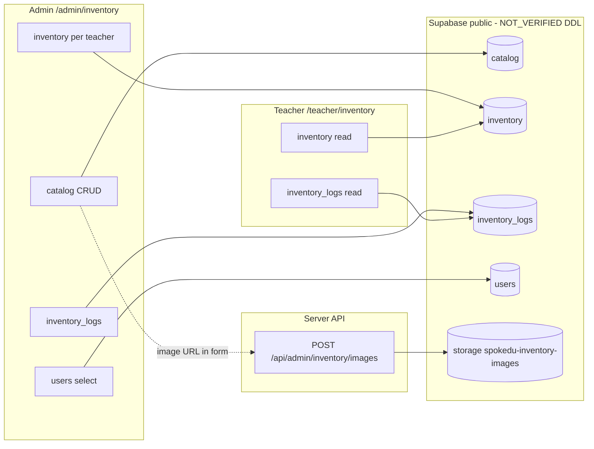

# SPOKEDU 교구 재고·수불 — 포렌식 감사 (Stage 0)

**문서 버전:** 2026-10-30  
**상태:** 코드·HTML·저장소 SQL 기준 감사 완료. **운영 DB DDL·RLS·행 수는 `NOT_VERIFIED`.**  
**코드 변경:** 없음 (감사 전용)

---

## 1. 감사 범위 및 방법

### 1.1 검색 범위 (저장소 전수)

| 영역 | 방법 | 결과 요약 |
|------|------|-----------|
| UI | `**/*inventory*`, `/admin/inventory`, `/teacher/inventory` | 관리자·강사 2페이지 + 사이드바 링크 |
| API | `app/api/**/inventory**` | 이미지 업로드 1 Route만 존재 |
| DB 호출 | `rg` on `from('catalog'|'inventory'|'inventory_logs')` | 4 파일 (admin/teacher inventory, sync-by-email, migrate script) |
| 마이그레이션 | `supabase/migrations/*.sql` + `sql/**` | `catalog`/`inventory` **CREATE TABLE DDL 없음**; RPC·버킷 1건 |
| 테스트 | `*.test.ts` inventory 키워드 | `teacherMaterialsPaths.test.ts` (경로 게이트만) |
| HTML 원본 | `c:\Users\user\Desktop\교구 수불대장.html` | 로컬 파일 전체 JS 감사 |

### 1.2 운영 DB

- **접근:** 본 감사 세션에서 운영/스테이징 PostgreSQL에 연결하지 않음.
- **결론:** 테이블 DDL, 제약, RLS, 트리거, 실제 row count, 마이그레이션 drift는 **`NOT_VERIFIED`**.
- **코드에서 추론 가능한 컬럼 사용**은 §3에 “클라이언트 계약”으로만 기록 (스키마 확정 아님).

---

## 2. 시스템 아키텍처 (현행)



**핵심:** 창고 총보유·대여 원장 테이블 **없음**. `catalog`는 마스터(메타+이미지), `inventory`는 **강사별 보유 스냅샷**(이름·메타 중복 저장).

---

## 3. 테이블 참조 관계 (코드 기준)

### 3.1 `public.catalog`

| 참조 위치 | 연산 | 필드 (select/insert/update) |
|-----------|------|-----------------------------|
| `app/admin/inventory/page.tsx` | SELECT, INSERT, UPDATE, DELETE | `id, name, category, image, simple_desc, key_points, usage_examples, created_at` |
| `scripts/migrate-inventory-base64-images.mjs` | SELECT (마이그레이션 스크립트) | `id, image` |
| `supabase/migrations/20261018110000_*.sql` | RPC `admin_cas_inventory_image` | `image` CAS 업데이트 |

**다른 기능 참조:** SPOMOVE/공개 `field-records-catalog`, `action_catalog`, `mr_field_source_catalog` 등 **별도 SSOT** — 교구 `public.catalog`와 **무관** (이름만 “catalog”).

**FK:** 코드상 `inventory` → `catalog.id` **없음**.

### 3.2 `public.inventory`

| 참조 위치 | 연산 | 필드 |
|-----------|------|------|
| `app/admin/inventory/page.tsx` | SELECT, INSERT, UPDATE, DELETE | `id, user_id, name, quantity, category, image, simple_desc, key_points, usage_examples, updated_at` |
| `app/teacher/inventory/page.tsx` | SELECT | `*` |
| `app/api/admin/teachers/sync-by-email/route.ts` | UPDATE `user_id` | 강사 ID 병합 시 |
| `sql/sync_*_teacher*.sql` | UPDATE `user_id` | 일회성 동기화 스크립트 |
| `scripts/migrate-inventory-base64-images.mjs` | SELECT | `id, image` |

**연결 방식:** 배부 시 `catalog` 행을 드래그/버튼으로 넘기면 **`name` 문자열 일치**로 기존 행 merge (`processAddItem`, L131–164).

### 3.3 `public.inventory_logs`

| 참조 위치 | 연산 | 필드 |
|-----------|------|------|
| `app/admin/inventory/page.tsx` | SELECT (limit 50), INSERT, DELETE | `id, user_id, content, type, created_at` |
| `app/teacher/inventory/page.tsx` | SELECT (limit 30) | `*` |

**성격:** 구조화된 대여/반납 원장 **아님** — `content` 자유 텍스트, `type` ∈ `in|out|info`.

### 3.4 `public.users`

| 참조 위치 | 용도 |
|-----------|------|
| `app/admin/inventory/page.tsx` | `id, name, role, is_active` — **`is_active=true`만**, role 필터 **없음** |
| `app/teacher/inventory/page.tsx` | 본인 `name` |
| `sync-by-email` | inventory/logs의 `user_id` 재매핑 |

---

## 4. 페이지·API 기능 감사

### 4.1 `app/admin/inventory/page.tsx` (~582 lines, 단일 파일)

| 기능 | 구현 | DB 쓰기 |
|------|------|---------|
| 교구 카탈로그 조회 | `fetchCatalog` | SELECT catalog |
| 등록·수정 | `handleSaveCatalog` | INSERT/UPDATE catalog |
| 삭제 | `handleDeleteCatalog` | DELETE catalog (확인만, 연관 inventory 미검사) |
| 이미지 | `handleImageUpload` → `/api/admin/inventory/images` | Storage; URL을 catalogForm에 저장 |
| 강사 목록 | `fetchTeachers` | SELECT users WHERE is_active |
| 강사 선택·보유 교구 | `fetchTeacherData` | SELECT inventory, logs |
| DnD / + 버튼 배부 | `processAddItem` | inventory INSERT/UPDATE (+1 고정) |
| 수량 직접 수정 | `commitQuantity` | inventory UPDATE |
| 전량 반납 | `handleReturnAll` | **inventory DELETE** |
| 활동 로그 | `addLog` | INSERT inventory_logs (별도 요청) |
| 로그 삭제 | UI X 버튼 | DELETE inventory_logs |
| 상세 모달 | catalog/teacher 카드 | 읽기 전용 UI |
| 모바일 | 사이드바, 그리드, sticky header | — |
| 관리자 인증 | **`page.tsx` 내부 검증 없음** — `app/admin/layout.tsx` → `/api/auth/check-admin` | — |

**클라이언트 Supabase:** 모든 catalog/inventory/logs **변경이 브라우저 `getSupabaseBrowserClient()` direct write** (`.cursor/rules/avoid-breaking-admin-by-rls-changes.mdc` 대상).

### 4.2 `app/teacher/inventory/page.tsx`

| 기능 | 구현 |
|------|------|
| 본인 교구·로그 조회 | RLS 전제 SELECT |
| 수정/반납 | **없음** (읽기 전용) |
| 헤더 `Total: {inventory.length}` | **품목 종류 수** (수량 합 아님) |
| `updated_at` 표시 | “수령일”로 라벨링 (실제는 row 갱신 시각) |

### 4.3 `app/api/admin/inventory/images/route.ts`

- `requireAdmin()` + `getServiceSupabase()` — **패턴 준수**.
- SHA256 경로, 10MB, jpeg/png/webp/gif.
- 버킷 `spokedu-inventory-images` (migration에서 public bucket 15MB limit 정의).

### 4.4 네비게이션

- `app/components/Sidebar.tsx` — `교구·재고` → `/admin/inventory`
- `app/teacher/layout.tsx` — `교구목록` → `/teacher/inventory`

---

## 5. DB 저장소 증거 (마이그레이션·RPC)

### 5.1 확인된 SQL (`supabase/migrations/20261018110000_phase2_settlement_and_inventory_primitives.sql`)

- `public.admin_cas_inventory_image(p_table, p_id, p_expected_md5, p_next_image)` — **service_role 전용**.
- Storage bucket `spokedu-inventory-images` idempotent create.

### 5.2 **NOT_VERIFIED**

- `catalog`, `inventory`, `inventory_logs` CREATE TABLE, PK/FK, CHECK, INDEX.
- RLS ENABLE/POLICY (저장소 `rg` **0건**).
- 트리거, realtime publication.
- 운영 row count, name/catalog 불일치 건수.

### 5.3 클라이언트가 가정하는 타입 (스키마 후보, 미확정)

```text
catalog.id          → number (bigint 추정)
inventory.id        → number
inventory.user_id   → uuid (users.id)
inventory.quantity  → number (integer 추정)
inventory_logs.type → text ('in'|'out'|'info')
```

---

## 6. 지시서 §2.4 — 현행 코드 결함 검증

| # | 위험 | 확인 | 위치 | 조건 | 영향 | 심각도 |
|---|------|------|------|------|------|--------|
| 1 | 배부와 이력이 별도 요청 | **CONFIRMED** | `processAddItem` → inventory write 후 `addLog` | 네트워크/RLS 중간 실패 | 수량만 변하고 로그 없음 또는 그 반대 | **High** |
| 2 | 동시 수량 수정 충돌 | **CONFIRMED** | `commitQuantity`, `processAddItem` | optimistic lock 없음 | last-write-wins, 음수/과다 배부 | **High** |
| 3 | 이름 기준 연결 | **CONFIRMED** | L133 `i.name === item.name` | catalog_id 없음 | 동명이 교구 merge, rename 시 고아/분열 | **High** |
| 4 | 창고·강사 정합성 부재 | **CONFIRMED** | 아키텍처 | 창고 qty 없음 | “총보유/가용” 개념 불가, 무한 배부 가능 | **Critical** |
| 5 | 전체 반납 = 행 삭제 | **CONFIRMED** | `handleReturnAll` DELETE | 반납 | 이력은 텍스트 로그만, 구조화 미반납 qty 없음 | **Medium** |
| 6 | catalog 삭제 영향 | **CONFIRMED** | `handleDeleteCatalog` | FK 없음 | 강사 inventory 스냅샷은 잔존, 마스터만 삭제 | **Medium** |
| 7 | 이력 50건 제한 | **CONFIRMED** | L77, L109 | 강사 선택 시 | UI에 50건만, 강사 30건 | **Low** |
| 8 | 이력 삭제 | **CONFIRMED** | L494 | 관리자 UI | 감사 추적 훼손 | **High** |
| 9 | 강사 role 필터 | **CONFIRMED** | `fetchTeachers` | is_active만 | admin/staff가 목록에 포함될 수 있음 | **Medium** — **서버 role 정책 `NOT_VERIFIED`** |
| 10 | 이미지 업로드 | **PARTIAL** | images route OK; catalog save는 client | 비관리자는 layout 차단 | direct catalog update는 RLS **`NOT_VERIFIED`** | **Medium** |

---

## 7. HTML 원본 (`교구 수불대장.html`) 결함 검증

| # | 위험 | 판정 | 근거 (함수·라인) |
|---|------|------|------------------|
| 1 | 총보유 < 대여량 수정 | **CONFIRMED** | `entryForm` submit — `qty_total`만 검증, rented 미검사 (L612–643) |
| 2 | 가용 부족 숨김 | **CONFIRMED** | `getAvailableQty` = `max(0, total-rented)` (L447–449) — 부족분 음수 미표시 |
| 3 | 프리셋 자동 생성 재고 | **CONFIRMED** | `applyPresetsToTeacher` L784–798 — 없으면 qty_total=1 생성 |
| 4 | 과거 이력 삭제 | **CONFIRMED** | `deleteRental` L747–752 |
| 5 | 전체 초기화 | **CONFIRMED** | `clearAll` L754–760 |
| 6 | 중복 ID | **CONFIRMED** | `Date.now()` / `Date.now()+random` (L625, L711, L791) |
| 7 | 잘못된 대여 수량 | **PARTIAL** | submit 시 `qty > getAvailableQty` 차단 (L706–708); HTML `max` 속성만으로는 우회 가능 |
| 8 | 날짜/타임존 | **CONFIRMED** | `toISOString().slice(0,10)` vs 수동 date input — KST 경계 **`INVESTIGATE`** |
| 9 | XSS | **CONFIRMED** | `innerHTML` + template `${i.name}` (L463–482 등) |
| 10 | localStorage 다중 사용자 | **CONFIRMED** | `KEY_ITEMS`/`KEY_RENTALS` — 브라우저 로컬 SSOT |

---

## 8. 교차 기능 참조 (inventory 테이블)

`inventory` / `inventory_logs`는 **교구 UI + 강사 ID sync** 외 런타임 참조 **없음** (SPOMOVE catalog, mileage, sessions와 **분리**).

`catalog`(public)는 **교구 admin 페이지 + 이미지 마이그레이션 + CAS RPC**만.

---

## 9. 감사 결론

| 항목 | 결과 |
|------|------|
| 현행 제품 의미 | “강사별 보유 스냅샷 + 마스터 카탈로그 + 텍스트 활동 로그” |
| 목표 제품 의미 (지시서) | “교구별 창고 재고 + 대여 원장 + 강사 보유 정합” |
| 격차 | **구조적** — UI 교체만으로 해결 불가 |
| DB DDL in repo | **缺失** → 운영 스키마 확인 전 마이그레이션 확정 금지 |
| 권장 다음 단계 | 운영 DB read-only 스키마 덤프 + RLS inventory + row 통계 → Stage 1 설계 확정 |

**보고 상태:** `AUDIT_COMPLETE` (코드/HTML) / DB 실측 `NOT_VERIFIED`
